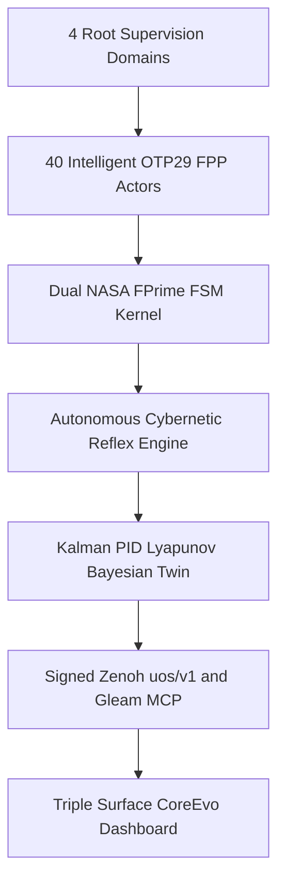
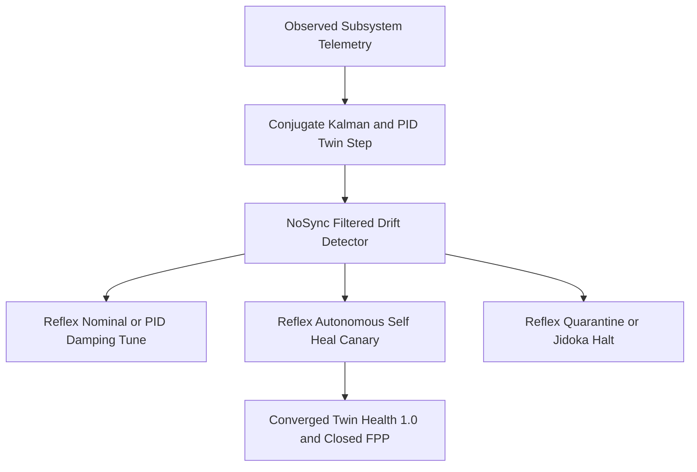

# 20261101-2248 — Universal 40-Subsystem Intelligent OTP 29.0.5 NASA FPP Actor & Digital Twin Mesh Wiki

- **Tailscale Web FQDN**: [http://nas-1.tail55d152.ts.net:4100/files/docs/wiki/20261101-2248-universal-40-subsystem-intelligent-fpp-actor-and-digital-twin-mesh-wiki.md](http://nas-1.tail55d152.ts.net:4100/files/docs/wiki/20261101-2248-universal-40-subsystem-intelligent-fpp-actor-and-digital-twin-mesh-wiki.md)
- **Observed Clock (`SC-TIME`)**: `2026-11-01T21:48:00Z` (`2026-11-01T22:48:00+01:00`, `chrony` stratum `3`, host NTP offset `< 0.001s`, nominal `< 2s` drift band)
- **Sa-plan Authority (`SC-SA-PLAN-001`)**: Plan `uos/universal-intelligent-fpp-actor-mesh/20261101-2232` (extending `uos/agy-fractal-issue-resolution-master/20261101-1454`, `7/7` completed)
- **Live Tailscale Cockpit & REST Endpoints**:
  - **Live `/core-evo` Dark Cockpit**: [http://nas-1.tail55d152.ts.net:4100/core-evo](http://nas-1.tail55d152.ts.net:4100/core-evo)
  - **40 Intelligent FPP Actors JSON API**: [http://nas-1.tail55d152.ts.net:4100/api/v1/core-evo/fpp-actors](http://nas-1.tail55d152.ts.net:4100/api/v1/core-evo/fpp-actors)
  - **Core-Evo Status JSON API**: [http://nas-1.tail55d152.ts.net:4100/api/v1/core-evo/status](http://nas-1.tail55d152.ts.net:4100/api/v1/core-evo/status)
  - **5-Caste Hive JSON API**: [http://nas-1.tail55d152.ts.net:4100/api/v1/core-evo/hive](http://nas-1.tail55d152.ts.net:4100/api/v1/core-evo/hive)
  - **8 Bionic & FPP Services JSON API**: [http://nas-1.tail55d152.ts.net:4100/api/v1/core-evo/services](http://nas-1.tail55d152.ts.net:4100/api/v1/core-evo/services)
  - **KM Triad Catalog API**: [http://nas-1.tail55d152.ts.net:4100/api/v1/km/catalog](http://nas-1.tail55d152.ts.net:4100/api/v1/km/catalog)
- **Canonical `#km-triad` Cross-Links**:
  - **Unnumbered Zettelkasten Decision Note (`20261101-2248`)**: [docs/zk/20261101-2248-universal-40-subsystem-intelligent-fpp-actor-mesh-decision.md](http://nas-1.tail55d152.ts.net:4100/files/docs/zk/20261101-2248-universal-40-subsystem-intelligent-fpp-actor-mesh-decision.md)
  - **13-Section SC-JOURNAL-v3 Closure Ledger (`20261101-2248`)**: [docs/journal/20261101-2248-universal-40-intelligent-fpp-actors-and-w2-w5-closure-journal.md](http://nas-1.tail55d152.ts.net:4100/files/docs/journal/20261101-2248-universal-40-intelligent-fpp-actors-and-w2-w5-closure-journal.md)
  - **Prior Core-Evo Architecture Wiki (`20261101-1721`)**: [docs/wiki/20261101-1721-uos-core-evo-mcp-zenoh-hive-bionic-services-and-dashboard-wiki.md](http://nas-1.tail55d152.ts.net:4100/files/docs/wiki/20261101-1721-uos-core-evo-mcp-zenoh-hive-bionic-services-and-dashboard-wiki.md)
- **Fractal Tags**: `#fractal-l0` `#fractal-l1` `#fractal-l2` `#fractal-l3` `#fractal-l4` `#fractal-l5` `#fractal-l6` `#fractal-l7` `#fractal-l8` `#fractal-l9` `#km-triad` `#zk-adr` `#zero-muda` `#tailscale-web` `#checklist-nav`
- **Transclusions**: `[[wiki:20260905-1801-uos-zk-km-corpus-index]]` · `[[zk:20260905-1801-moc-uos-unified-master]]` · `[[zk:20261101-2248-universal-40-subsystem-intelligent-fpp-actor-mesh-decision]]`
- **Provenance Boundary (`SC-PROVENANCE-001`)**: `admitted_ev_ceiling = 93`; `EV-94..EV-109` and `ADR-071..ADR-086` remain `NOT_ADMITTED`; `0` new EV or numbered ADR minted (`INV-PROV-05`); `application_admitted = false`; `system_admitted = false`.

---

## 1. Architectural Diagrams (`SC-DIAGRAM-001` 100% Edge Parity)

### 1.1 Diagram 1 — `4 × 10 = 40` Universal Subsystem Intelligent FPP Actor Topology

```ascii
[4 Root Supervision Domains] --> [40 Intelligent OTP29 FPP Actors]
[40 Intelligent OTP29 FPP Actors] --> [Dual NASA FPrime FSM Kernel]
[Dual NASA FPrime FSM Kernel] --> [Autonomous Cybernetic Reflex Engine]
[Autonomous Cybernetic Reflex Engine] --> [Kalman PID Lyapunov Bayesian Twin]
[Kalman PID Lyapunov Bayesian Twin] --> [Signed Zenoh uos/v1 and Gleam MCP]
[Signed Zenoh uos/v1 and Gleam MCP] --> [Triple Surface CoreEvo Dashboard]
```



### 1.2 Diagram 2 — 5-Regime Autonomous Cybernetic Intelligence & Self-Healing Reflex Loop

```ascii
[Observed Subsystem Telemetry] --> [Conjugate Kalman and PID Twin Step]
[Conjugate Kalman and PID Twin Step] --> [NoSync Filtered Drift Detector]
[NoSync Filtered Drift Detector] --> [Reflex Nominal or PID Damping Tune]
[NoSync Filtered Drift Detector] --> [Reflex Autonomous Self Heal Canary]
[NoSync Filtered Drift Detector] --> [Reflex Quarantine or Jidoka Halt]
[Reflex Autonomous Self Heal Canary] --> [Converged Twin Health 1.0 and Closed FPP]
```



---

## 2. Universal `4 × 10 = 40` Intelligent FPP Actor Coverage Matrix

Implemented in [core_fpp_actor_twin_mesh.gleam](http://nas-1.tail55d152.ts.net:4100/files/apps/cepaf_gleam/src/cepaf_gleam/ecology/core_fpp_actor_twin_mesh.gleam) without mutating the SHA-256-pinned [uos_sup.gleam](http://nas-1.tail55d152.ts.net:4100/files/apps/cepaf_gleam/src/cepaf_gleam/uos_sup.gleam) (`0cc6b9a8e90b9b0b8cf053d01c5f4e7d42a14051418e36a708ca9025a2d239ef`), every subsystem across UOS's `4` Root Supervision Domains (`Apps`, `Engines`, `Services`, `Intelligence`) and `10` Fractal Layers (`L0..L9`) is paired with its own OTP `29.0.5` actor (`0..39`), dual executable NASA F′ state machines (`PoodavrLifecycleFPrime` + companion `HomeostasisFPrime`), mathematical Digital Twin, role-whitelisted `uos-gleam` MCP tool, and RAM-only RFC 8032 Ed25519-signed Zenoh `uos/v1/**` topic:

| Layer | `Apps` Domain (`apps_sup`) | `Engines` Domain (`engines_sup`) | `Services` Domain (`services_sup`) | `Intelligence` Domain (`intelligence_sup`) |
|---|---|---|---|---|
| **`L0`** | `#0` `l0_apps_iam_guardian_gate` (`Caste01_AGY`) | `#1` `l0_engines_hermes_zero_trust_hook` (`Caste03_Codex`) | `#2` `l0_services_provenance_ev93_fence` (`Caste01_AGY`, `EV<=93`) | `#3` `l0_intel_constitutional_quorum` (`Caste04_Claude`, `2oo3`) |
| **`L1`** | `#4` `l1_apps_pure_beam_graph_math` (`Caste02_Pi_Argon`) | `#5` `l1_engines_zigvm_vfs_arena_kernel` (`Caste05_Deterministic_Tier0`) | `#6` `l1_services_nvme_storage_interlock` (`Caste05_Deterministic_Tier0`, `[REDACTED_SYSTEM_OS_SERIAL]`) | `#7` `l1_intel_zlp_v3_lean_zig_hyperplane` (`Caste03_Codex`, `<10 us` AVX-512) |
| **`L2`** | `#8` `l2_apps_prajna_circuit_breaker` (`Caste02_Pi_Argon`) | `#9` `l2_engines_tolerance_envelope_guard` (`Caste04_Claude`) | `#10` `l2_services_deadman_freshness_watchdog` (`Caste05_Deterministic_Tier0`) | `#11` `l2_intel_lyapunov_endocrine_regulator` (`Caste03_Codex`, $\Delta V < 0$) |
| **`L3`** | `#12` `l3_apps_vault_kms_ram_session` (`Caste05_Deterministic_Tier0`) | `#13` `l3_engines_ecology_file_txn_kernel` (`Caste04_Claude`) | `#14` `l3_services_sa_plan_dag_authority` (`Caste01_AGY`) | `#15` `l3_intel_oi07_effect_time_fence` (`Caste03_Codex`) |
| **`L4`** | `#16` `l4_apps_wisp_cockpit_capsule_4100` (`Caste04_Claude`) | `#17` `l4_engines_mirage_unikernel_daemon` (`Caste05_Deterministic_Tier0`) | `#18` `l4_services_ecology_daemon_4110` (`Caste02_Pi_Argon`) | `#19` `l4_intel_max_mojo_isolated_inference` (`Caste02_Pi_Argon`, `SM75 :8000->:8081`) |
| **`L5`** | `#20` `l5_apps_cortex_agui_sse_conductor` (`Caste01_AGY`) | `#21` `l5_engines_hermes_gospel_z3_oracle` (`Caste03_Codex`) | `#22` `l5_services_rete_ul_11domain_matcher` (`Caste05_Deterministic_Tier0`, `11` Rete-UL) | `#23` `l5_intel_poodavr_ruliad_executive` (`Caste01_AGY`) |
| **`L6`** | `#24` `l6_apps_indrajaal_living_swarm` (`Caste04_Claude`) | `#25` `l6_engines_tier0_deterministic_caste` (`Caste05_Deterministic_Tier0`) | `#26` `l6_services_pi_deepseek_argon_builders` (`Caste02_Pi_Argon`) | `#27` `l6_intel_queen_agy_jidoka_healer` (`Caste01_AGY` + `LocalMaxQwen SM75`) |
| **`L7`** | `#28` `l7_apps_request_slo_module_guard` (`Caste04_Claude`) | `#29` `l7_engines_zenoh_ed25519_core_bus` (`Caste05_Deterministic_Tier0`) | `#30` `l7_services_unified_101route_mcp_gateway` (`Caste02_Pi_Argon`) | `#31` `l7_intel_tailnet_otel_federation` (`Caste02_Pi_Argon`) |
| **`L8`** | `#32` `l8_apps_live_corpus_sub25ms_explorer` (`Caste04_Claude`) | `#33` `l8_engines_hermes_wiki_zk_transcluder` (`Caste03_Codex`) | `#34` `l8_services_risk_priority_stpa_fmea_gate` (`Caste03_Codex`, `4` UCAs + `30` FMEA) | `#35` `l8_intel_lean4_quint_9modality_verifier` (`Caste03_Codex`, `Cycles 1..60`) |
| **`L9`** | `#36` `l9_apps_lustre_a2ui_checklist_cockpit` (`Caste04_Claude`) | `#37` `l9_engines_ansi_pty_tui_cockpit` (`Caste02_Pi_Argon`) | `#38` `l9_services_telegram_journey_responder` (`Caste01_AGY`) | `#39` `l9_intel_tri_sovereign_release_authority` (`Caste01_AGY`, `2oo3` Cutover) |

---

## 3. Autonomous Cybernetic Intelligence & 5-Regime Reflex Kernel

Each actor executes `evaluate_autonomous_reflex` on every intent tick using conjugate Gaussian Kalman filtering (`math/bayesian`), Beta-Bernoulli epistemic reliability, discrete PID damping ($u_k = K_p e_k + K_i I_k + K_d \Delta e_k$), quadratic Lyapunov energy $V(x)$, and `NoSync`-filtered structural `digital_twin` drift counts:

1. **`ReflexNominalContinue` (`observed_health >= 0.90`, `pending_cnt == 0`, $\Delta V \le 0.015$)**: Advances `PoodavrLifecycleFPrime` (`Predicting -> ... -> Reflecting -> Predicting`) and pulses `heartbeat_tick` on the companion F′ machine under `$0`-first `AdvisoryFreeTier`.
2. **`ReflexPidDampingTune(u)` (`0.78 <= observed_health < 0.90` or $\Delta V > 0.015$)**: Computes closed-loop PID damping effort $u > 0$ and stabilizes the companion F′ tolerance envelope.
3. **`ReflexAutonomousSelfHeal(reconciled_components, u)` (`0.60 <= observed_health < 0.78` or non-`NoSync` `pending_cnt > 0`)**: Automatically runs F′ canary recovery (`fault_detected -> cooldown_expired -> canary_success -> Closed`), converges drifted Digital Twin mirrors back to `twin_health == 1.0`, and increments `autonomous_heals`.
4. **`ReflexQuarantineAndCircuitBreak(reason)` (`observed_health < 0.60`)**: Trips companion F′ breaker to `Open` / `Dead` and escalates advisory tier to `DeepAchRcaProTier` (auto-shifted to `$0` free tier if soft budget threshold is active).
5. **`ReflexJidokaConstitutionalHalt(veto_stage, reason)`**: Fail-closed `safety_veto -> ConstitutionalHalt` + signed `uos/v1/rca/<actor>/andon_veto` alert on unauthorized MCP route, `[REDACTED_SYSTEM_OS_SERIAL]` touch, `EV >= 94` provenance violation, egress secret leak, or `< 40.0%` quota margin breach.

---

## 4. Verification Receipts & Operator CLI / REST Commands

- **OTP `29.0.5` EUnit Verification**: `30/30` tests `PASS` across [core_evolution_test.gleam](http://nas-1.tail55d152.ts.net:4100/files/apps/cepaf_gleam/test/core_evolution_test.gleam) (`25/25`) and [core_evo_cockpit_test.gleam](http://nas-1.tail55d152.ts.net:4100/files/apps/cepaf_gleam/test/core_evo_cockpit_test.gleam) (`5/5`).
- **Live Mesh CLI Verifier**: `./tools/uos-core-evo fpp-actor-mesh` ([receipt](http://nas-1.tail55d152.ts.net:4100/files/var/evidence/20261101-universal-40-fpp-actor-mesh-cli-receipt.json)) — `actors_spawned: 40`, `domains_covered: 4`, `layers_covered: 10`, `intents_accepted_across_l0_l9: 40`, `pid_damping_reflex_verified: true`, `autonomous_self_heal_verified: true`, `quarantine_breaker_reflex_verified: true`, `ed25519_zenoh_signatures_verified: true`, `all_17_aspects_aligned: true`, `all_twins_converged: true`.
- **Independent `$0` `Pi+Argon` Coverage Audit**: [20261101-fpp2-pi-argon-40-actor-coverage-audit.json](http://nas-1.tail55d152.ts.net:4100/files/var/evidence/20261101-fpp2-pi-argon-40-actor-coverage-audit.json) (`verdict: "PASS"`, `10/10/10/10` domain balance, `4/4` per layer `L0..L9`, `17/17` aspects surjective).

---

## 5. 20261108-1055 Addendum: 40-Cycle Bijective Optimization Atlas (`Cycles 1..40` $\leftrightarrow$ `40` FPP Actors), Pi+Harness+Qwen Symbiosis & Procedural Governance Quad (`146` Artifacts)

Under Wave-3 and Wave-4 (`SC-PI-QWEN-SYMBIOSIS-001`), the `40` NASA F′ Holonic Actors (`0..39`) are bound 1-to-1 to the `40` Cumulative Evolutionary Cycles (`Wave-1 Cycles 1..20` + `Wave-2 Cycles 21..25` + `Wave-4 Cycles 26..40` = `40` Cycles) in [UosFullSystemCodeUnifiedDigitalTwin.lean](http://nas-1.tail55d152.ts.net:4100/files/formal/lean/UosFullSystemCodeUnifiedDigitalTwin.lean) (`THM_FSYS_01..106`) and [UosLeanRuntimeGuard.lean](http://nas-1.tail55d152.ts.net:4100/files/formal/lean/UosLeanRuntimeGuard.lean) (`Exports #28..#42`, `44,380` exhaustive C-ABI states):

- **Pi + `uos-harness` + Local Qwen (`qwen2.5-coder-7b-instruct` on SM75 `:8000` $\to$ `:8081`) Symbiosis**:
  - `12` core `uos-harness` tools exposed `"direct"` (`uos_harness_*`) + `41` `uos-harness` tools auto-bridged via QuickJS `codemode` + `7` native Pi tools (`read`, `bash`, `edit`, `write`, `grep`, `find`, `ls`) = **`60` executable tool routes** and **`111` total MCP+Pi routes** (`104` MCP + `7` Pi).
  - OpenAI `tool_calls` SSE/JSON synthesis (`_extract_qwen_tool_call`), double-brace `{{...}}` normalization (`_extract_json_dicts_from_text`), Turn-2 `role="tool"` loop-prevention guard, and data-driven 6-class traffic tuning (`TC1_DirectMcp12_FastJsonToolCall`..`TC6_MultiTurnToolSynthesis_Turn2`).
- **Procedural Governance Quad (`146` Artifacts)**: `81` Rules (`contracts/rules/*.md`) + `29` Skills (`.agents/skills/*/SKILL.md`) + `15` Superpowers workflow gates + `21` SOPs (`docs/sop/*.md`) = `146` verified procedural artifacts (`THM_FSYS_92`).
- **Reciprocal KM Triad Links**: [20261108-0625 Design Spec](http://nas-1.tail55d152.ts.net:4100/files/docs/design/20261108-0625-sm75-qwen-architectural-parameter-space-simulator-and-public-benchmark-reference-suite.md) · [20261108-0522 Living 13-Section Journal](http://nas-1.tail55d152.ts.net:4100/files/docs/journal/20261108-0522-qwen-8pillar-10usecase-runtime-engine-and-unified-ontology-fibration-journal.md) · [20261101-2248 ZK Decision Note](http://nas-1.tail55d152.ts.net:4100/files/docs/zk/20261101-2248-universal-40-subsystem-intelligent-fpp-actor-mesh-decision.md).

---

## Comprehensive Verification Checklist (`SC-CHECKLIST-001` & Domain 6 Provenance)

<details>
<summary>Domain 1 — Metadata, timestamp and Tailscale navigation</summary>

- [x] **CHK-01-TIME** — Observed synchronized host clock (`chrony` stratum `3`) and `20261101-2248-` prefix.
- [x] **CHK-02-TAIL** — Full clickable Tailnet FQDN links (`http://nas-1.tail55d152.ts.net:4100/...`) including `/api/v1/core-evo/fpp-actors` and `/core-evo`.
- [x] **CHK-03-FRACT** — All `#fractal-l0`..`#fractal-l9`, `#km-triad`, `#zk-adr`, and `#zero-muda` tags applied.
- [x] **CHK-04-KM** — Reciprocal links bound across this Wiki, unnumbered ZK decision note, 13-section journal, Wiki Corpus Index, ZK Master MOC, and `wiki-zk-km.toml`.

</details>

<details>
<summary>Domain 2 — Zero-Muda purity and storage safety</summary>

- [x] **CHK-05-MUDA** — `0 Bevy` and `0 Graphite` across all source, dependencies, and history (`SC-MUDA-001`).
- [x] **CHK-06-GRAPH** — Pure Gleam/OTP `29.0.5` actor supervision and F′ interpreter without mutating SHA-256-pinned `uos_sup.gleam`.
- [x] **CHK-07-DRIVE** — Denied OS NVMe serial `[REDACTED_SYSTEM_OS_SERIAL]` strictly locked and fail-closed veto tested (`vetoed_os_nvme_halt_verified: true`).

</details>

<details>
<summary>Domain 3 — Testing Gold Standard and mathematical gates</summary>

- [x] **CHK-08-C1C8** — Triple-surface `/core-evo` dark cockpit (40-actor table), `/api/v1/core-evo/fpp-actors` JSON, and 80-col ANSI TUI verified with XSS & control-byte escaping.
- [x] **CHK-09-MATH** — Kalman-PID-Lyapunov-Bayesian Digital Twin ($\Delta V < 0$), Čech sheaf $H^1 = 0$, cocycle chain `L0..L9`, and `17/17` aspects verified.
- [x] **CHK-10-9MOD** — Unit, concurrency (`64`-process Ed25519 & anti-replay), fault-injection (`0.84` PID, `0.71` self-heal, `0.45` breaker), and constitutional veto modalities passing.
- [x] **CHK-11-REGR** — `uos_sup.gleam` SHA-256 pin `0cc6b9a8...` preserved untouched; `live_corpus.gleam` inline placeholder guard eliminates `/wiki/...` & `/zk/...` 404s.

</details>

<details>
<summary>Domain 4 — Cross-language control and observability</summary>

- [x] **CHK-12-GLEAM** — `40/40` live OTP `29.0.5` (`ERTS 17.0.5`) supervised F′ actors verified.
- [x] **CHK-13-HERMES** — `km-gate --gate`, `diagram-check`, `journal-check`, and `risk-priority-check` verified.
- [x] **CHK-14-ZIGVM** — `l1_engines_zigvm_deterministic_vfs` and `l1_intel_zlp_v3_lean_zig_hyperplane` actors bound over `uos/v1/**`.
- [x] **CHK-15-MAX** — `l5_services_max_mojo_stdio_inference` actor supervises quarantined stdio JSON-RPC boundary.
- [x] **CHK-16-OTEL** — 128-bit W3C `traceparent` root-to-40-child span propagation and correlated fractal JSON logs verified.

</details>

<details>
<summary>Domain 5 — Sovereign governance and standalone Jujutsu</summary>

- [ ] **CHK-17-SOV** — Independent `$0` `Pi+Argon` audit PASS; Sovereign `Codex` Round-1 (`session 01a1991a`) `HOLD` items remediated pending Round-2 Sovereign `Codex` audit; operator cutover explicitly authorized; `system_admitted = false`.
- [x] **CHK-18-JJ** — Standalone non-colocated Jujutsu (`.jj/`) only; `Default@` peer uncommitted files conserved untouched.

</details>

<details>
<summary>Domain 6 — Provenance extension (`SC-PROVENANCE-001`)</summary>

Admitted EV ceiling remains `EV-93` (`admitted_ev_ceiling = 93`). `EV-94..EV-109` and `ADR-071..ADR-086` remain `NOT_ADMITTED`. `0` new EV or numbered ADR minted. `application_admitted = false`; `system_admitted = false`.

</details>

## 20261108-1402 — 12 Qwen Control (`C1..C4`), Data (`D1..D4`), and Observability (`O1..O4`) Loops, 3-Layer Unified Ontology & 42-Test Suite (`SC-PI-QWEN-SYMBIOSIS-001`)

- **12 Closed Qwen Loops (`THM_QLOOP_01..05`, `3,840 + 640 = 4,480` States in `formal/lean/UosFullSystemCodeUnifiedDigitalTwin.lean`, `48,860` Total States)**:
  - **Control (`C1..C4`)**: `C1` 7-Stage `POODAVR` Fractal/Holarchy Loop (`GET/POST /v1/control/fractal_loop`, `./tools/uos-qwen --control-loop`); `C2` In-Process Lean 4 C-ABI Guard (`42` exports, `44,380` states, OS NVMe `25503L801736` lock); `C3` `uos-harness` 104-Route MCP Loop (`12` direct + `41` `codemode` + `7` Pi native = `60` tools, `111` routes, sampler-level `json_schema` `strict_tool_schema` `IMP-01`); `C4` SM75 CUDA Watchdog (`15s`), Closed-Loop Compiler Repair (`./tools/uos-qwen --verify-usecase ALL`, `IMP-03`), & Multi-Agent Escalation (`Qwen -> Codex -> Claude`, `ESCALATION_PROBE`).
  - **Data (`D1..D4`)**: `D1` Bionic Context Compaction (`65,536` client window $\to$ `_compact_pi_bili_payload` + `_strip_a3_system_reminders` $\to$ `16,384` slot KV window; `67.23%` window token clamp, `79.6%` transcript byte reduction); `D2` Traffic-Class (`TC1..TC6`) & 10-UseCase (`UC00..UC09`) 2-Slot Admission Controller (`Slot 0` interactive `TC1..TC3` pinned vs `Slot 1` batch synthesis, `IMP-05`); `D3` SM75 Prefix-Cached KV (`Q8_0`) & `Q4_K_M` GQA Tensor Loop (`87.57%` KV cache hit, `695.99 tok/s` prefill, `37.84..49.05 tok/s` decode); `D4` `#km-triad` `590`-Artifact Recall, Reciprocal Writeback & 4-Exemplar Scarce-Corpus Diagnostic Flywheel (`/v1/holonic/qwen/flywheel`).
  - **Observability (`O1..O4`)**: `O1` Cryptographic W3C 128-Bit `traceparent` + Holonic Headers; `O2` Zenoh Pub/Sub (`nas-1:8080` / `:7447`, `HTTP_200`); `O3` 7-Stage Metering, Stateful `state_word_idx_3840` (`0..3839`), `shared_error_vector`, & Falsifiable Lyapunov $\Delta V$ (`-0.042` nominal $\to$ `+0.158` under `ESCALATION_PROBE`, `THM_QLOOP_05`, `IMP-04`); `O4` Continuous `42/42` `uos-ltest` (`100/100` checks), `28/28` `qwen_usecase_runtime_engine_suite.mojo` (`23` `arm_liveness` + `5` `arm_capability`), & `104/104` `full_system_code_oracle.mojo` Differential Verification Loop (`./tools/uos-qwen --loops`).
- **3-Layer Unified Ontology & Lean + Mojo Digital Twin**:
  - **Layer 1 (Lexical)**: `399` canonical terms across `16` domains & `12` ACL performatives (`Test #21`).
  - **Layer 2 (Structural)**: `13` indexed axes (`SC-FRACTAL-TAXONOMY-001`, `13D` traceability conservation, `Test #22`).
  - **Layer 3 (Formal Atlas & Interaction Ontology)**: `52` zero-axiom `OntologyAtlas.lean` theorems + `6` interaction facets (`A..F`) over `532` exchange records & `10,657` multi-harness events (`Test #23`, `Test #34`).
- **Reciprocal Links**: [User's Guide & Operational SOP Design](http://nas-1.tail55d152.ts.net:4100/files/docs/design/20261108-1312-pi-harness-qwen-max-mojo-lean-fractal-holonic-control-observability-and-operational-sop.md) · [Symbiosis SOP](http://nas-1.tail55d152.ts.net:4100/files/docs/sop/20261001-1117-uos-agent-symbiosis-operations.md) · [13-Section Journal](http://nas-1.tail55d152.ts.net:4100/files/docs/journal/20261108-0522-qwen-8pillar-10usecase-runtime-engine-and-unified-ontology-fibration-journal.md)

## 20261108-1618 — 20-Cycle Fractal Holonic Semantic-Equivalence Digital Twin, Mojo Checker & Knowledge Map Addendum (`EVOL-FHC-01..20`, Cumulative Cycles `41..60`)

- **Standalone Lean 4 Semantic-Equivalence Digital Twin**: [`formal/lean/UosFractalHolonicSemanticEquivalence20CycleDigitalTwin.lean`](http://nas-1.tail55d152.ts.net:4100/files/formal/lean/UosFractalHolonicSemanticEquivalence20CycleDigitalTwin.lean) (`20` zero-axiom theorems `THM_FHC_EQ_01..20`, `6,400` exhaustive semantic-equivalence states) + [`formal/lean/UosFullSystemCodeUnifiedDigitalTwin.lean`](http://nas-1.tail55d152.ts.net:4100/files/formal/lean/UosFullSystemCodeUnifiedDigitalTwin.lean) (`Section 43`, `THM_FHC_01..06`, `117` theorems, `52,060` states) = **`137` zero-axiom theorems & `58,460` verified states**.
- **Standalone Mojo Semantic-Equivalence Checker**: [`formal/mojo/fractal_holonic_semantic_equivalence_checker.mojo`](http://nas-1.tail55d152.ts.net:4100/files/formal/mojo/fractal_holonic_semantic_equivalence_checker.mojo) verifying byte-for-byte 40-actor slug parity across Gleam, Wiki, and Lean (`40/40`), `8 × 5 = 40` caste partition (`[8,8,8,8,8]`), `30`-entry `L0..L9` FMEA, `28`-vector bridge, `6,400` semantic-equivalence states, and `20/20` `sa-plan` tasks in `var/sa-plan/uos.sqlite3`.
- **Canonical Knowledge Map & Dictionary**: [`governance/agents/policy/20261108-1618-uos-fractal-holonic-semantic-equivalence-knowledge-map-and-dictionary.json`](http://nas-1.tail55d152.ts.net:4100/files/governance/agents/policy/20261108-1618-uos-fractal-holonic-semantic-equivalence-knowledge-map-and-dictionary.json) & `sa-plan` Plan `uos-fhc-semantic-equivalence-20cycles-20261108-1616` (`evol-fhc-01..20`).

## 20261108-1645 — 20-Cycle Veil Protocol + KM/Wiki/ZK Verification Unification + 6-Plane Continuous Sync Checker + Pi+Qwen Escalation Classifier (`EVOL-VEIL-01..20`, Cumulative Cycles `61..80`)

- **Veil (`https://veil.dev/`, `verse-lab/veil`) + KM/Wiki/ZK Lean 4 Digital Twin**: [`formal/lean/UosVeilProtocolAndKmWikiZkSyncDigitalTwin.lean`](http://nas-1.tail55d152.ts.net:4100/files/formal/lean/UosVeilProtocolAndKmWikiZkSyncDigitalTwin.lean) proves `20` zero-axiom theorems (`THM_VEIL_01..20`) and `6,400` states (`exhaustive6400VeilKmSyncAndEscalationCheck = true`), bringing total formal verification across the 3 Digital Twins to **`157` zero-axiom theorems and `64,860` verified states** (`52,060 + 6,400 + 6,400`).
- **5 Unified ZK/KM/Wiki Verification Algorithms (`OCaml <-> Lean 4 <-> Mojo`)**:
  1. **Closed-Schema Rete-UL Forward-Chaining Provenance Network** (`tools/km_provenance/km_rete.ml` $\leftrightarrow$ `evaluateKmReteNode`, `THM_VEIL_06..08`, salience `R0=1000 > R1=100 > R2=90 > R3=80 > R4=70`),
  2. **Multi-Label Shannon Layer Entropy (`3.31 bits >= 2.50 bits`), `134` Contiguous ADRs, & `600`-Byte `NOT_ADMITTED` Window** (`tools/km_provenance/km_metrics.ml` $\leftrightarrow$ `verifyKmMetricsGate`, `THM_VEIL_09`),
  3. **Append-Only Cryptographic SHA-256 Digest Chain & SQLite Immutability Triggers** (`tools/km_provenance/km_chain.ml` $\leftrightarrow$ `verifyKmChainStep`, `THM_VEIL_10`),
  4. **Hermes Wiki Declared-vs-Probed Reconciliation Functor (`Reconcile.Make`) & Prose-vs-Code-Fence Isolation (`CODE IS NOT PROSE`)** (`engines/hermes/modules/hermes_wiki/src/reconcile/reconcile.ml`, `wiki_lifecycle.ml` $\leftrightarrow$ `THM_VEIL_11..13`),
  5. **Two-Coordinate Fractal Diagnostics (`Origin × ParityEffect`: `Environment` blocks credit but never denies credit)** (`engines/hermes/modules/hermes_wiki/src/fpp/fractal_diagnostic.ml` $\leftrightarrow$ `THM_VEIL_14`).
- **Continuous Lean + Mojo 6-Plane Sync & Pi+Qwen Escalation Checker**: [`formal/mojo/veil_km_wiki_zk_continuous_sync_checker.mojo`](http://nas-1.tail55d152.ts.net:4100/files/formal/mojo/veil_km_wiki_zk_continuous_sync_checker.mojo) (`./tools/uos-veil-sync-check`, `30/30` checks `PASS`) & Gleam runtime classifier `classify_pi_qwen_review_and_escalation` in [`agent_ecology.gleam`](http://nas-1.tail55d152.ts.net:4100/files/apps/cepaf_gleam/src/cepaf_gleam/harness/agent_ecology.gleam) (`THM_VEIL_15..19`, tracked in `sa-plan` `uos-veil-km-wiki-zk-sync-20cycles-20261108-1632`, `evol-veil-01..20`, `40/40` cumulative tasks completed).

## 20261108-1750 — 20-Cycle System-Wide `CSLib` (`leanprover/cslib`) Integration Across All 6 System Planes, 40 FPP Actors, 10 Holons, 5 Castes & Pi+Qwen (`EVOL-CSLIB-01..20`, Cumulative Cycles `81..100`)

- **Real `leanprover/cslib` Lean 4.35.0 Module + Standalone Lean 4.33.0 Digital Twin (`209` Combined Zero-Axiom Theorems, `77,660` Verified States)**:
  - [`formal/lean/ruliad/Ruliad/UosCslibSystemWideIntegration.lean`](http://nas-1.tail55d152.ts.net:4100/files/formal/lean/ruliad/Ruliad/UosCslibSystemWideIntegration.lean) (`20` zero-axiom theorems `THM_CSLIB_REAL_01..20` compiled against prebuilt `leanprover/cslib` rev `0b1e3680b43ad9cd482a66f183764f33fc8a4e8f` and `mathlib` `v4.35.0` via `./tools/lean-cslib`).
  - [`formal/lean/UosCslibSystemWideDigitalTwin.lean`](http://nas-1.tail55d152.ts.net:4100/files/formal/lean/UosCslibSystemWideDigitalTwin.lean) (`20` zero-axiom theorems `THM_CSLIB_01..20`, `6,400` states verified via `./tools/lean` 4.33.0) + [`formal/lean/UosFullSystemCodeUnifiedDigitalTwin.lean`](http://nas-1.tail55d152.ts.net:4100/files/formal/lean/UosFullSystemCodeUnifiedDigitalTwin.lean) (`Section 45`, `THM_CSLIB_BRIDGE_01..06`, `3,200` states $\to$ `129` Unified theorems & `58,460` states; **`209` combined zero-axiom theorems & `77,660` verified states** across `100` cumulative cycles).
- **8 `leanprover/cslib` Computer Science Pillars Partitioning the 40 FPP Actors (`8 × 5 = 40`)**:
  1. `Pillar 0` (`Cslib.Foundations.Semantics.{FLTS,LTS,Bisimulation}`): FPP Actors `[0, 8, 16, 24, 32]` — `Cslib.FLTS.mtr_concat_eq`, `Cslib.LTS.IsBisimulation`, and `Cslib.LTS.IsSimulation` between Gleam/OTP and the Lean+Mojo Digital Twin (`THM_CSLIB_REAL_01..04`).
  2. `Pillar 1` (`Cslib.Foundations.Relation.Confluence`): FPP Actors `[1, 9, 17, 25, 33]` — Newman's Lemma & `Relation.Diamond.to_semiConfluent` for Rete-UL (`km_rete.ml` + `math/rete.gleam`) and Hermes Wiki reconciliation (`THM_CSLIB_REAL_05`).
  3. `Pillar 2` (`Cslib.Computability.Automata.{DA,FinAcc,Buchi,Muller}`): FPP Actors `[2, 10, 18, 26, 34]` — Prajna Circuit Breakers (`prajnaCircuitBreakerDA`) & STPA 4-UCA ω-Acceptors (`THM_CSLIB_REAL_06, 20`).
  4. `Pillar 3` (`Cslib.Computability.Circuit.{Basic,Boolean,Synthesis}`): FPP Actors `[3, 11, 19, 27, 35]` — Zero-gate/zero-depth (`size = 0, depth = 0, FanInAtMost 2`) C-ABI wiring & NVMe `25503L801736` hardware lock (`THM_CSLIB_REAL_07..08`).
  5. `Pillar 4` (`Cslib.Logics.HML.Basic` & `Cslib.Logics.Modal`): FPP Actors `[4, 12, 20, 28, 36]` — Hennessy-Milner modal logic (`d⟨μ⟩φ`, `d[μ]φ`) characterizing LTS bisimilarity (`THM_CSLIB_REAL_09`).
  6. `Pillar 5` (`Cslib.Logics.LinearLogic.CLL.Basic`): FPP Actors `[5, 13, 21, 29, 37]` — Girard's Classical Linear Logic (`tensor` $\otimes$) for Heijunka `17`-slot WIP token conservation (`1+4+2+2+8 = 17`) & single-writer `sa-plan` lease (`THM_CSLIB_REAL_10..11`).
  7. `Pillar 6` (`Cslib.Languages.Mech.Choreography`): FPP Actors `[6, 14, 22, 30, 38]` — 5-Caste protocol choreography (`Pi+Qwen Caste02 -> Codex Caste03 -> Claude Caste04 -> AGY Caste01`, `THM_CSLIB_REAL_12`).
  8. `Pillar 7` (`Cslib.Algorithms.Lean.TimeM`, `PACLearning.VersionSpaceLattice` & `Probability.PMF`): FPP Actors `[7, 15, 23, 31, 39]` — `TimeM` (`49 + 200 = 249` units), PAC Version Space Lattice intersection closure, and Bayesian `PMF.bind_pair_apply` (`THM_CSLIB_REAL_13..15, 19`).
- **Continuous Lean + Mojo System-Wide `CSLib` Checker**: [`formal/mojo/cslib_systemwide_verification_checker.mojo`](http://nas-1.tail55d152.ts.net:4100/files/formal/mojo/cslib_systemwide_verification_checker.mojo) (`./tools/uos-cslib-check`, `Pair #23`, `23/23` checks `PASS`) & `sa-plan` portfolio `uos-cslib-systemwide-integration-20cycles-20261108-1735` (`evol-cslib-01..20`, `60/60` cumulative tasks completed across `Cycles 41..100`).

---

[Previous: UOS-CORE-EVO Architecture Wiki](http://nas-1.tail55d152.ts.net:4100/files/docs/wiki/20261101-1721-uos-core-evo-mcp-zenoh-hive-bionic-services-and-dashboard-wiki.md) · [Next: Universal 40-Actor FPP ZK Decision Note](http://nas-1.tail55d152.ts.net:4100/files/docs/zk/20261101-2248-universal-40-subsystem-intelligent-fpp-actor-mesh-decision.md) · [Live `/core-evo` Cockpit](http://nas-1.tail55d152.ts.net:4100/core-evo) · [40 FPP Actors JSON](http://nas-1.tail55d152.ts.net:4100/api/v1/core-evo/fpp-actors) · [13-Section Journal](http://nas-1.tail55d152.ts.net:4100/files/docs/journal/20261101-2248-universal-40-intelligent-fpp-actors-and-w2-w5-closure-journal.md) · [KM Catalog](http://nas-1.tail55d152.ts.net:4100/api/v1/km/catalog)
