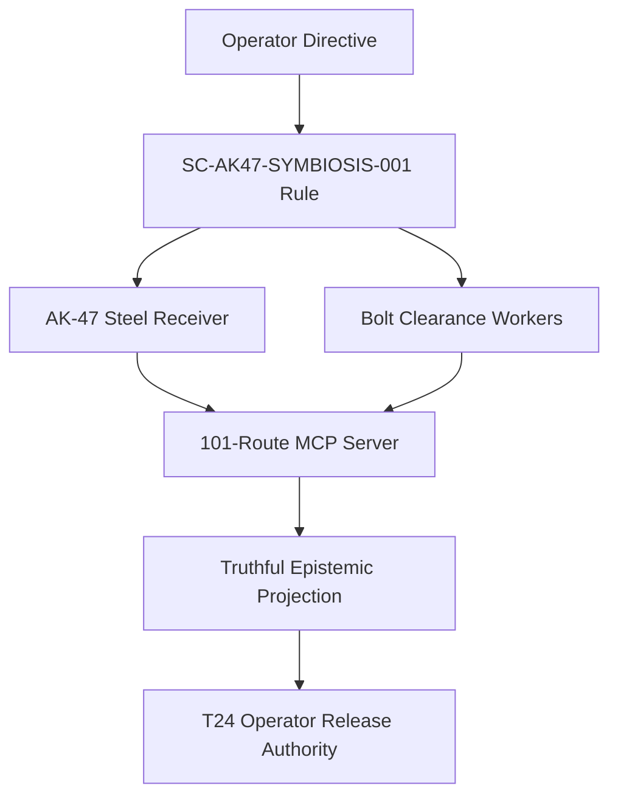

# ADR: 20261030-1058 — AK-47 Multi-Agent Supervision and Unified 101-Route MCP Architecture

- **ADR ID**: `ADR-AK47-SYMBIOSIS-001`
- **Contract ID**: `SC-AK47-SYMBIOSIS-001`
- **Status**: RATIFIED (specification only; grants no runtime admission)
- **Date**: 2026-10-30T10:58:00Z
- **Author**: `AGY Argon` supervisor session (UOS-local)
- **Sa-Plan Reference**: `uos/ak47-multi-agent-mcp-symbiosis/20261030-1058`
- **Tailscale FQDN**: [http://nas-1.tail55d152.ts.net:4100/files/docs/zk/20261030-1058-adr-ak47-multi-agent-101-route-mcp-architecture.md](http://nas-1.tail55d152.ts.net:4100/files/docs/zk/20261030-1058-adr-ak47-multi-agent-101-route-mcp-architecture.md)

#fractal-l0 #fractal-l1 #fractal-l2 #fractal-l3 #fractal-l4 #fractal-l5 #fractal-l6 #fractal-l7 #fractal-l8 #fractal-l9 #zk-adr #zero-muda #tailscale-web

**Navigation:** [Cockpit](http://nas-1.tail55d152.ts.net:4100/) · [Wiki](http://nas-1.tail55d152.ts.net:4100/wiki) · [ZK](http://nas-1.tail55d152.ts.net:4100/zk) · [Rule](http://nas-1.tail55d152.ts.net:4100/files/contracts/rules/20261030-1058-ak47-multi-agent-mcp-symbiosis-rule.md) · [Client guide](http://nas-1.tail55d152.ts.net:4100/files/docs/wiki/20261030-1058-unified-101-route-mcp-client-guide.md) · [ADR source](http://nas-1.tail55d152.ts.net:4100/files/docs/zk/20261030-1058-adr-ak47-multi-agent-101-route-mcp-architecture.md)

Transclusions: [[wiki:20261030-1058-unified-101-route-mcp-client-guide]] · [[wiki:20260905-1801-uos-zk-km-corpus-index]]

## 1. Context & architectural drivers

The fleet runs parallel agent workers against a single control plane while the operator requires that authority, safety and critical code never be loosened by parallel motion. Two failures recur: (1) a green worker or board ACK being read as admission, and (2) a shared dispatcher being edited concurrently by disjoint workers. The server surface had also accumulated transport- and version-specific assumptions instead of one declared 101-route topology.

## 2. Decision

1. **AK-47 design principle.** Authority, safety, admission, provenance, secret hygiene, effect fencing and the 28-module critical control path are an unbreakable **steel receiver**. Parallel disjoint-file workers run with **bolt clearance**: one bounded file set each, new files only, never a shared dispatcher. **Zero Muda**: pull dependency-ready slices, merge verified work, stop.
2. **Strict supervisor persona.** `AGY Argon` supervises, integrates and verifies but does not implement what it approves. Fast disjoint slices run on `Pi + DeepSeek-v4.1-Flash` `--thinking low` with the 8-flag Zero-Muda isolation bundle at a measured **-99.2% prompt-token overhead**; complex multi-file integration and security slices run on `Codex`; independent falsification runs on `Claude` `--allowedTools Read`.
3. **Unified 101-route MCP server.** **65** public routes across **9 domain adapters** + **21** development routes + **15** successor routes. Transports: **stdio**, **Zenoh** HMAC-fenced, and **Streamable HTTP** Bearer / Origin / session-fenced (the `http_auth.gleam` Origin allowlist is HTTPS-only and Tailscale-FQDN-shaped: `https://nas-1.tail55d152.ts.net:4100`; `http://` and raw IP literals are refused). Protocol versions **`2024-11-05`** (`Legacy20241105`) and **`2026-07-28`** (`Modern20260728`), matching `mcp/version.gleam` and `transports/http.gleam`.

**Catalog reconciliation note (`tools.gleam`).** The public catalog declares **65** public tools: **53** are listed directly in the default legacy unauthenticated `tools/list` (`tools.operational_tool_definitions()` = 65 declared minus 12 unavailable), and **12** gated domain tools (`control_loop`, `safety_status`, `run_selfcheck`, `registry_status`, `run_gate`, `zk_search`, `sa_bridge_submit`, `vault_status`, `vault_list_secrets`, `vault_policy_get`, `vault_audit_tail`, `vault_health`) fail closed with `UNAVAILABLE` on unauthenticated/unconfigured legacy calls and execute only through authenticated typed adapters in `server.execute_route_authenticated`. `65 declared − 12 unavailable = 53 advertised`, matching the T19 receipt's `tools_listed_count: 53`; `tools/list` and `tools/call` must tell the same story.
4. **Truthful epistemic projection.** `Refused` != `Operational`; completed tasks alone != green readiness; raw review cannot be overridden; `DEV_READY` != `SYSTEM_ADMITTED`; live cutover requires separate **T24 operator release authority**.

## 3. Diagram (SC-DIAGRAM-001)

The ASCII arrow list and the `mermaid` graph below describe the same nodes and edges.

```text
[Operator Directive] --> [SC-AK47-SYMBIOSIS-001 Rule]
[SC-AK47-SYMBIOSIS-001 Rule] --> [AK-47 Steel Receiver]
[SC-AK47-SYMBIOSIS-001 Rule] --> [Bolt Clearance Workers]
[AK-47 Steel Receiver] --> [101-Route MCP Server]
[Bolt Clearance Workers] --> [101-Route MCP Server]
[101-Route MCP Server] --> [Truthful Epistemic Projection]
[Truthful Epistemic Projection] --> [T24 Operator Release Authority]
```



The directive yields the rule; the rule splits into the steel receiver and the bolt-clearance workers, both feeding the 101-route server, whose projection finally requires the separate T24 operator release authority.

## 4. Consequences

- Positive: authority is centralized in a hash-gated receiver; parallel throughput is bounded and honest; one server topology with explicit fences and versions.
- Negative/limits: the route count, the token-overhead measurement and the fence behavior are **declared**, not verified here; client adoption is **UNRUN**; nothing in this ADR performs a cutover.
- Neutral: the imported `pi-prompt` and `codex-symbiosis` skills remain read-only; the UOS-local skill supersedes their stale paths.

## 5. Alternatives considered

- A single monolithic worker: rejected — no clearance, poor throughput, Zero-Muda inventory.
- Shared-dispatcher parallel edits: rejected — violates the steel receiver.
- Multiple transport-specific servers: rejected — duplicated authority and drift.

## Comprehensive verification checklist

Checks below are obligations for work governed by this record, not blanket passing claims. This is a documentation package: runtime items are **unchecked**.

<details><summary>Domain 1 — Metadata, timestamp and Tailscale navigation</summary>

- [x] **CHK-01-TIME** — `20261030-1058` prefix recorded.
- [x] **CHK-02-TAIL** — Full Tailnet links provided; live serving status not asserted here.
- [x] **CHK-03-FRACT** — L0–L9 tags plus `#zk-adr #zero-muda #tailscale-web`.
- [x] **CHK-04-KM** — Wiki and ZK transclusions plus rule, guide and ADR links present.

</details>

<details><summary>Domain 2 — Zero-Muda purity and storage safety</summary>

- [ ] **CHK-05-MUDA** — Dependency exclusion scan UNRUN.
- [ ] **CHK-06-GRAPH** — Pure BEAM/Hermes graph boundary UNRUN.
- [ ] **CHK-07-DRIVE** — OS storage interlock execution UNRUN.

</details>

<details><summary>Domain 3 — Testing Gold Standard and mathematical gates</summary>

- [ ] **CHK-08-C1C8** — Applicable C1–C8 surfaces UNRUN.
- [ ] **CHK-09-MATH** — Four declared mathematical gates UNRUN.
- [ ] **CHK-10-9MOD** — Nine runtime test modalities UNRUN.
- [ ] **CHK-11-REGR** — Regressions and bounded observation UNRUN.

</details>

<details><summary>Domain 4 — Cross-language control and observability</summary>

- [ ] **CHK-12-GLEAM** — Actual OTP control/supervision behavior UNRUN.
- [ ] **CHK-13-HERMES** — Bounded analysis and authoritative evidence UNRUN.
- [ ] **CHK-14-ZIGVM** — Deterministic execution and descriptor-relative VFS UNRUN.
- [ ] **CHK-15-MAX** — Isolated inference UNRUN.
- [ ] **CHK-16-OTEL** — Clock and nonzero trace/span identity UNRUN.

</details>

<details><summary>Domain 5 — Sovereign governance and standalone Jujutsu</summary>

- [ ] **CHK-17-SOV** — Candidate-bound independent review and authorized admission NOT_ADMITTED.
- [ ] **CHK-18-JJ** — Standalone JJ, source ownership and exact candidate identity UNRUN.

</details>

<details><summary>Domain 6 — Provenance extension</summary>

EV ceiling remains 93. EV-94..109 remain NOT_ADMITTED. No new EV number is minted. This ADR mints no EV identifier.

</details>

**UOS footer:** ZK decision record; document evidence grants no system admission.
