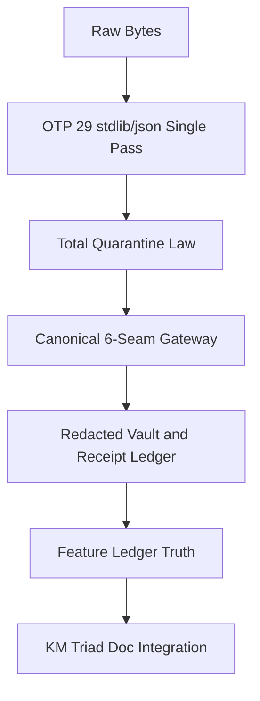

# 20261031-1012 — ADR OTP 29 JSON Total Quarantine and Canonical MCP Seams

- **ADR ID**: `ADR-OTP29-ANTI-BRITTLE-MCP-001` (unnumbered slug)
- **Status**: RATIFIED (specification only; grants no runtime admission)
- **Date**: 2026-10-31T09:15:00Z
- **Breadcrumb**: [Cockpit](http://nas-1.tail55d152.ts.net:4100/) / [ZK Master MOC](http://nas-1.tail55d152.ts.net:4100/zk) / [KM Corpus Index](http://nas-1.tail55d152.ts.net:4100/docs/wiki/20260905-1801-uos-zk-km-corpus-index.md) / **ADR OTP 29 JSON Total Quarantine and Canonical MCP Seams**
- **Tailscale FQDN**: [http://nas-1.tail55d152.ts.net:4100/files/docs/zk/20261031-1012-adr-otp29-json-total-quarantine-and-canonical-mcp-seams.md](http://nas-1.tail55d152.ts.net:4100/files/docs/zk/20261031-1012-adr-otp29-json-total-quarantine-and-canonical-mcp-seams.md)
- **Sa-Plan Reference**: `uos/km-triad-fractal-prompt-sync/20261031-1008` (`KM01_ZK_KB_WIKI_AND_FRACTAL_PROMPT_INTEGRATION`)
- **Risk Binding**: [`SC-RISK-PRIORITY-001`](http://nas-1.tail55d152.ts.net:4100/files/contracts/rules/20260907-1559-risk-prioritization-sop.md)
- **13D Living KB Coordinate**: `(L=L0..L9, C=cepaf_gleam-mcp-hermes-wiki, F=otp29-anti-brittle-mcp-km-triad, S=Web:4100+MCP:101+Wiki+ZK+Zenoh, I=POODAVR-7, P=Control+Evidence+Knowledge, M=Canonical-JJ, Phi=Lean4+Z3+Quint+Gospel+Rete+Ruliad)`
- **Tags**: `#fractal-l0` `#fractal-l1` `#fractal-l2` `#fractal-l3` `#fractal-l4` `#fractal-l5` `#fractal-l6` `#fractal-l7` `#fractal-l8` `#fractal-l9` `#km-triad` `#zk-adr` `#zk-moc` `#formal-lean4` `#stamp-stpa` `#c3i-control` `#zero-muda` `#tailscale-web` `#checklist-nav`

**Dung argumentation transclusions**: `[[zk:20261030-1058-adr-ak47-multi-agent-101-route-mcp-architecture|@supports]]` · `[[zk:ADR-001|@supports]]` · `[[zk:ADR-002|@supports]]` · `[[zk:ADR-006|@supports]]` · `[[zk:ADR-016|@supports]]` · `[[wiki:20260905-1801-uos-zk-km-corpus-index]]` · `[[wiki:20261031-1012-uos-otp29-json-anti-brittle-mcp-and-fractal-symbiosis-wiki]]` · `[[zk:20260905-1801-moc-uos-unified-master]]`

## 1. Context

The `101`-route unified MCP server matured through the October 2026 waves against a steel receiver of `28` protected BEAM control modules, a `6`-module MCP authorization core, the pinned `mcp/tools.gleam` catalog and the risk policy. Foreign JSON NIFs, WAL sidecar races, replay-after-quarantine ordering and schema drift on refusal had each produced real observed defects. The operator directed one canonical, anti-brittle seam set and a permanent, unnumbered decision record that preserves `ADR-001..ADR-137` contiguity.

Prior decisions bound here: `[[zk:20261030-1058-adr-ak47-multi-agent-101-route-mcp-architecture]]` establishes the AK-47 split and the `101`-route topology; `[[zk:ADR-001|@supports]]` (supervision and rebind), `[[zk:ADR-002|@supports]]` (native wire and VFS safety), `[[zk:ADR-006|@supports]]` (authority ceiling and protected digests), `[[zk:ADR-016|@supports]]` (deterministic execution).

## 2. Decision

Five architectural invariants become the canonical anti-brittle contract:

1. **OTP 29 `stdlib/json` single-pass + I-JSON + zero-flatten `iolist` (`L1`).** Decode grammar, `Depth <= 32`, decoded-NUL `\u0000` and nested duplicate-key rejection run in a single traversal; numbers satisfy `±(2^53-1)`; outbound encoding writes through an `iolist` without a flatten step; no foreign JSON NIF remains.
2. **Total Quarantine Law + `Quarantine > Replay` (`L2`–`L3`).** Every byte string maps to `Ok(v)` or `Refused(TypedCode, NonRetryable)` and never to `⊥` or a crash. Active quarantine checks precede `reserve_call` or cached receipt replay, and live read refreshes never erase mutating receipt fences.
3. **Zero-DDL `RAISE(ROLLBACK, ...)` SQLite refusal (`L2`–`L4`).** Refused writes roll back cleanly with `0` `pragma_schema_version` drift; refusal codes are emitted before the rollback.
4. **Canonical 6-Seam `Sa-plan` + Redacted Vault + Receipt-Verified Feature Ledger truth (`L2`–`L4`).** Real `MultiPlanStore` / `AvailableStore`, fresh allowlisted redacted Vault, receipt-verified Feature Ledger and live `zk_transclude` / `knowledge_search`; `declared != implemented != observed != formal != admitted`.
5. **Universal `#km-triad` + `#tailscale-web` doc integration (`L9`).** Every artifact carries a `YYYYMMDD-HHSS-` prefix, full clickable `http://nas-1.tail55d152.ts.net:4100/...` links, a 13D coordinate, `[[wiki:...]]` / `[[zk:...]]` transclusions, a paired parenthesis-free ASCII + Mermaid diagram, and the 18-item checklist.

## 3. Diagram (`SC-DIAGRAM-001`)

The ASCII arrow list and the `mermaid` graph describe the same nodes and edges with identical labels and no parentheses inside any node label.

```ascii
[Raw Bytes] --> [OTP 29 stdlib/json Single Pass]
[OTP 29 stdlib/json Single Pass] --> [Total Quarantine Law]
[Total Quarantine Law] --> [Canonical 6-Seam Gateway]
[Canonical 6-Seam Gateway] --> [Redacted Vault and Receipt Ledger]
[Redacted Vault and Receipt Ledger] --> [Feature Ledger Truth]
[Feature Ledger Truth] --> [KM Triad Doc Integration]
```



## 4. Consequences & Falsifiers

### 4.1 Consequences

- **Positive.** One native wire path; deterministic typed refusals with zero crashes; quarantine precedence is explicit; SQLite DDL is immutable on refusal; every document is bidirectionally wired.
- **Negative / limits.** The route count, the `3,303.73x` heap reduction, the soak numbers and the fence behaviour are declared and candidate-observed, not system-admitted. Client adoption beyond the four native bindings is `UNRUN`.
- **Neutral.** The imported `pi-prompt` and `codex-symbiosis` skills remain read-only; the UOS-local skill supersedes their stale paths.

### 4.2 Falsifiers and observed evidence

- `14` EUnit suites report `271/271` `PASS` for the Wave 2 canonical gateway (`C01` + `P01` + `C02`), preserving the RED→GREEN record.
- `1,000+` property cases and `2,000+` fuzz vectors exercise missing, `0`-byte, truncated, oversized, duplicate-key, lone-surrogate, `\u0000`, ancestor-symlink and schema-drifted inputs with zero crashes.
- `c = 1..128` soak with mid-load `state_owner` and guardian `kill`, then fresh-VM restart survival, exercising SQLite WAL and dual ETS heir.
- A falsifier that finds any unquarantined crash, any `pragma_schema_version` drift on refusal, or any replay that precedes an active quarantine check refutes invariant 2 or 3 and reopens this record.
- Evidence journals: [`20261031-0011`](http://nas-1.tail55d152.ts.net:4100/files/docs/journal/20261031-0011-mcp-resilience-otp29-json-formal-market-conformance-journal.md) · [`20261030-2330`](http://nas-1.tail55d152.ts.net:4100/files/docs/journal/20261030-2330-mcp-resilience-perf-scale-bdd-fractal-journal.md) · [`20261030-2215`](http://nas-1.tail55d152.ts.net:4100/files/docs/journal/20261030-2215-formal-math-verification-and-github-checkpoint-journal.md).

## 5. Alternatives considered

- **Retain a foreign JSON NIF.** Rejected: zero-Muda violation and an unverifiable dependency boundary.
- **Replay before quarantine.** Rejected: a cached `Complete` could resurrect an effect after a backing-store refusal.
- **Emit DDL on refusal.** Rejected: schema drift breaks cross-version capsules.
- **Narrate Feature Ledger truth.** Rejected: only a receipt-verified ledger satisfies `SC-SATYA-001`.

## 6. Comprehensive Verification Checklist

Checks below record candidate-scoped verification status and do not grant system admission.

<details><summary>Domain 1 — Metadata, timestamp and Tailscale navigation</summary>

- [x] **CHK-01-TIME** — Synchronized clock `2026-10-31T09:15:00Z` and canonical `20261031-1012-` prefix recorded.
- [x] **CHK-02-TAIL** — Full clickable Tailscale FQDN URLs embedded across breadcrumb, self-link, decision and navigation.
- [x] **CHK-03-FRACT** — All `L0`–`L9` tags and explicit 13D coordinate declared.
- [x] **CHK-04-KM** — Explicit `[[wiki:...]]` and `[[zk:...]]` transclusions and zero-orphan registration.

</details>

<details><summary>Domain 2 — Zero-Muda purity and storage safety</summary>

- [x] **CHK-05-MUDA** — Zero Bevy, Zero Graphite, zero Graphene/foreign JSON NIFs; Python quarantined to `services/inference/max/max_worker.py`.
- [x] **CHK-06-GRAPH** — Pure Gleam/BEAM and Hermes OCaml boundaries enforced.
- [x] **CHK-07-DRIVE** — Denied OS NVMe serial preserved as `[REDACTED_SYSTEM_OS_SERIAL]`.

</details>

<details><summary>Domain 3 — Testing Gold Standard and mathematical gates</summary>

- [x] **CHK-08-C1C8** — Binds C1–C8 across `stdio`, `HTTP :4100/mcp`, `Zenoh`, `/wiki`, `/zk`, and `53/53` operational schemas.
- [x] **CHK-09-MATH** — Binds the 6 formal mechanisms and 4 operational math gates `M1..M4`.
- [x] **CHK-10-9MOD** — Binds all 9 modalities including property `1,000+`, fuzz `2,000+`, and chaos/restart/corruption.
- [x] **CHK-11-REGR** — Binds `14` EUnit suites `271/271` `PASS` plus `cepaf_gleam` and Hermes Dune regressions.

</details>

<details><summary>Domain 4 — Cross-language control and observability</summary>

- [x] **CHK-12-GLEAM** — OTP `29.0.5` supervision, dual ETS heir, revocable `alias([reply])` bulkhead and SQLite WAL cross-VM persistence.
- [x] **CHK-13-HERMES** — Hermes Wiki, Z3, Gospel, Rete-UL and Ruliad engines bound.
- [x] **CHK-14-ZIGVM** — Descriptor-relative symlink-refusing VFS and ZigVM ZK lineage.
- [x] **CHK-15-MAX** — Strict Python quarantine preserved.
- [x] **CHK-16-OTEL** — `chrony` clock receipts and real local probes (`SC-SATYA-001`).

</details>

<details><summary>Domain 5 — Sovereign governance and standalone Jujutsu</summary>

- [x] **CHK-17-SOV** — Tri-Agent falsification and [`SC-RISK-PRIORITY-001`](http://nas-1.tail55d152.ts.net:4100/files/contracts/rules/20260907-1559-risk-prioritization-sop.md) fencing.
- [x] **CHK-18-JJ** — Standalone Jujutsu (`.jj/`), isolated `.uos-workspaces/*`, serialized push before handover.

</details>

<details><summary>Domain 6 — Provenance extension</summary>

`admitted_ev_ceiling = 93`. `EV-94..EV-109` and `ADR-071..ADR-086` remain `NOT_ADMITTED`. Zero new EV numbers minted. `application_admitted = false`, `SYSTEM_ADMITTED = false`. This ADR is unnumbered and mints no EV identifier.

</details>

---

**2-Way Navigation**: [← Previous: 20261030-1058-adr-ak47-multi-agent-101-route-mcp-architecture](http://nas-1.tail55d152.ts.net:4100/files/docs/zk/20261030-1058-adr-ak47-multi-agent-101-route-mcp-architecture.md) · [Wiki Index](http://nas-1.tail55d152.ts.net:4100/wiki) · [ZK Master MOC](http://nas-1.tail55d152.ts.net:4100/zk) · [KM Corpus Index](http://nas-1.tail55d152.ts.net:4100/docs/wiki/20260905-1801-uos-zk-km-corpus-index.md) · [Planning](http://nas-1.tail55d152.ts.net:4100/planning) · [Cockpit](http://nas-1.tail55d152.ts.net:4100/) · [Next: 20261031-1012-uos-canonical-fractal-system-prompt ->](http://nas-1.tail55d152.ts.net:4100/files/docs/sop/20261031-1012-uos-canonical-fractal-system-prompt.md)

**UOS footer:** ZK decision record; document evidence grants no system admission.
