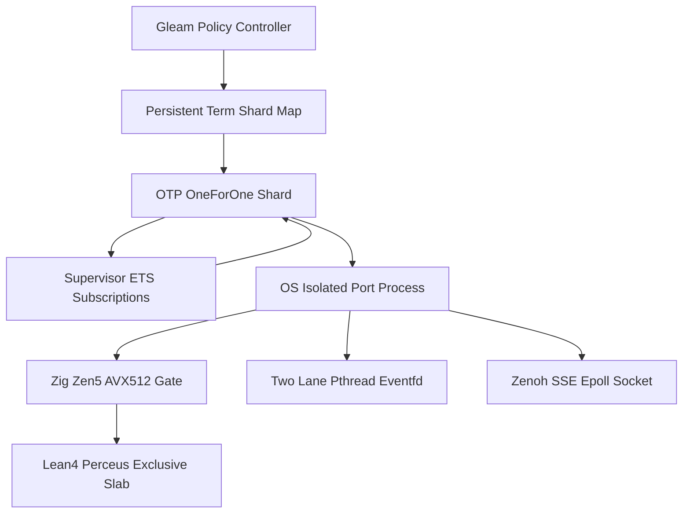

# 20261101-1248 — Zettelkasten Decision Note: Supervised OTP 29 Port Hyperplane (`UOS-ZLP-v3`) Over In-Process Dirty NIFs

- **Tailscale Web FQDN**: [http://nas-1.tail55d152.ts.net:4100/files/docs/zk/20261101-1248-zlp-v3-supervised-otp29-port-hyperplane-decision.md](http://nas-1.tail55d152.ts.net:4100/files/docs/zk/20261101-1248-zlp-v3-supervised-otp29-port-hyperplane-decision.md)
- **Observed Clock (`SC-TIME`)**: `2026-11-01T12:48:00Z` (`chrony` stratum `3`, system offset `+0.000201s` fast of NTP time, nominal `< 2s` drift band)
- **Decision Status**: `IMPLEMENTED_IN_SOURCE` (`application_admitted = false`, `system_admitted = false`; unnumbered ZK decision note per `INV-PROV-05` preserving `1..137` numbered ADR contiguity)
- **Sa-plan Authority (`SC-SA-PLAN-001`)**: Plan `uos/zlp-v3-supervised-hyperplane/20261101-1309` · Tasks `T01_ZLP_V3_HYPERPLANE_IMPL`, `T02_ZLP_V3_FULL_PROJECT_INTEGRATION_AND_DOCS`, `T03_ZLP_V3_TRIPLE_SURFACE_SKILL_CONTRACT_CLOSURE`
- **Reciprocal `#km-triad` Links**:
  - **Constitutional Port Contract (`SC-ZLP-PORT-001`)**: [contracts/rules/20261101-1410-zlp-hyperplane-port-contract.md](http://nas-1.tail55d152.ts.net:4100/files/contracts/rules/20261101-1410-zlp-hyperplane-port-contract.md)
  - **UOS-Local Agent Skill**: [.agents/skills/uos-zlp-hyperplane/SKILL.md](http://nas-1.tail55d152.ts.net:4100/files/.agents/skills/uos-zlp-hyperplane/SKILL.md)
  - **Design & Math Specification**: [docs/design/20261101-1225-uos-zlp-v3-lean4-zig-otp29-zenoh-hyperplane-spec.md](http://nas-1.tail55d152.ts.net:4100/files/docs/design/20261101-1225-uos-zlp-v3-lean4-zig-otp29-zenoh-hyperplane-spec.md)
  - **Hermes Wiki Guide**: [docs/wiki/20261101-1248-uos-zlp-v3-supervised-lean4-zig-otp29-zenoh-hyperplane.md](http://nas-1.tail55d152.ts.net:4100/files/docs/wiki/20261101-1248-uos-zlp-v3-supervised-lean4-zig-otp29-zenoh-hyperplane.md)
  - **Operations & Verification SOP**: [docs/sop/20261101-1248-uos-zlp-v3-hyperplane-operations-and-verification-sop.md](http://nas-1.tail55d152.ts.net:4100/files/docs/sop/20261101-1248-uos-zlp-v3-hyperplane-operations-and-verification-sop.md)
  - **Formal Proof Kernel**: [formal/lean/UosZlpHyperplane.lean](http://nas-1.tail55d152.ts.net:4100/files/formal/lean/UosZlpHyperplane.lean)
  - **Integration & Closure Journals**: [T02 Integration Journal](http://nas-1.tail55d152.ts.net:4100/files/docs/journal/20261101-1248-uos-zlp-v3-full-project-integration-journal.md) · [T03 Triple-Surface Closure Journal](http://nas-1.tail55d152.ts.net:4100/files/docs/journal/20261101-1410-uos-zlp-v3-triple-surface-skill-contract-closure-journal.md)
- **Fractal Tags**: `#fractal-l0` `#fractal-l1` `#fractal-l2` `#fractal-l3` `#fractal-l4` `#fractal-l5` `#fractal-l6` `#fractal-l7` `#fractal-l8` `#fractal-l9` `#km-triad` `#zk-adr` `#zero-muda` `#tailscale-web`
- **Transclusions**: `[[zk:20260905-1801-moc-uos-unified-master]]` · `[[wiki:20260905-1801-uos-zk-km-corpus-index]]` · `[[wiki:20261101-1248-uos-zlp-v3-supervised-lean4-zig-otp29-zenoh-hyperplane]]`

---

## 1. Context & Problem Statement

UOS requires combining:
1. **Mechanized theorem-proved decision kernels** (`Lean 4.33.0` C-ABI functions verifying 64-window anti-replay, topic confinement, scale/budget caps, and `SC-RISK-PRIORITY-001` risk scores),
2. **Hardware-symbiotic byte gatekeeping** (`Zig 0.16.0` Zen 5 512-bit AVX-512 NUL-byte and JSON structural depth scanning), and
3. **Live Zenoh pub/sub streaming** (`127.0.0.1:8080` SSE subscriptions plus `PUT`/`GET`)

under **Gleam/OTP 29.0.5** supervision without violating [SC-HARNESS-MCP-001](http://nas-1.tail55d152.ts.net:4100/files/contracts/rules/20260909-0412-gleam-harness-agent-operation-contract.md) or risking whole-VM (`beam.smp`) crashes. Prior to `UOS-ZLP-v3`, [indrajaal_native_zenoh.erl](http://nas-1.tail55d152.ts.net:4100/files/apps/cepaf_gleam/src/indrajaal_native_zenoh.erl) threw `erlang:nif_error(nif_not_loaded)` on `subscribe/3` and `get/2`, and [zenoh/client.gleam](http://nas-1.tail55d152.ts.net:4100/files/apps/cepaf_gleam/src/cepaf_gleam/zenoh/client.gleam) lacked live subscription support (`supports_subscriptions == False`).

---

## 2. Decision Topology & Fault-Containment Model (`SC-DIAGRAM-001`)

```ascii
[Gleam Policy Controller] --> [Persistent Term Shard Map]
[Persistent Term Shard Map] --> [OTP OneForOne Shard]
[OTP OneForOne Shard] --> [Supervisor ETS Subscriptions]
[OTP OneForOne Shard] --> [OS Isolated Port Process]
[OS Isolated Port Process] --> [Zig Zen5 AVX512 Gate]
[Zig Zen5 AVX512 Gate] --> [Lean4 Perceus Exclusive Slab]
[OS Isolated Port Process] --> [Two Lane Pthread Eventfd]
[OS Isolated Port Process] --> [Zenoh SSE Epoll Socket]
[Supervisor ETS Subscriptions] --> [OTP OneForOne Shard]
```



---

## 3. Architectural Decision & Competing Alternatives (`ACH`)

| Alternative | Safety & Performance Evaluation | Verdict |
|---|---|---|
| **A1 — In-Process Dirty NIF (`erl_nif.h` + `libleanshared.so` inside `beam.smp`)** | Sub-microsecond call entry, **but** any native segfault, allocator mismatch, Perceus RC bug across BEAM Dirty CPU threads, or Zenoh socket fault kills `beam.smp` and destroys all OTP supervision trees; Lean module initializers cannot be safely unloaded on hot-code reload. | **REJECTED** |
| **A2 — Single-Threaded Synchronous OS Port** | Isolates OS crashes, **but** Pollaczek-Khinchine $M/G/1$ service variance $\sigma_s^2$ causes multi-millisecond Heavy proofs to block microsecond Fast-Lane gates, and any worker crash drops live Zenoh subscriptions. | **REJECTED** |
| **A3 — Sharded Supervised OTP 29 Port Pool + Two-Lane `epoll`/`eventfd` + Dual-ETS Auto-Replay (`UOS-ZLP-v3`)** | OS process boundary isolates `SIGKILL` (`exit_status = 137`) to a single shard; `PR_SET_PDEATHSIG(SIGTERM)` prevents orphan leaks; `pthread` + `lean_initialize_thread()` + `eventfd` eliminates HoL blocking; supervisor-owned ETS replays Zenoh SSE subscriptions automatically on restart; `persistent_term` routing achieves $> 20,000$ RPS across 16 actors. | **SELECTED** |

---

## 4. Six Permanent Architectural Invariants

1. **Constitutional Authority Non-Escalation (`T20_no_autonomous_escalation`)**: Native Lean + Zig port workers never execute side effects outside bounded frame/risk computation and Zenoh transport framing behind Gleam's policy checks. `admitted_ev_ceiling = 93`; `system_admitted = false`.
2. **Pre-Perceus Zen 5 512-Bit AVX-512 Gatekeeping (`@Vector(64, u8)`)**: Embedded NUL bytes (`status = 2`) and JSON nesting $> 32$ (`status = 3`) are rejected in Zig SIMD registers before touching Lean heap memory.
3. **Perceus `ST` Zero-Copy Exclusivity (`excl == 1`, `T03`)**: Each shard pre-allocates a `48 KiB` `ByteArray` slab (matching Zen 5 $L_{1d}$ cache capacity) and asserts `lean_is_exclusive(slab) == 1` on every response receipt.
4. **Two-Lane Out-of-Order Multiplexing (`T11_two_lane_nonblocking`)**: Fast-Lane opcodes (`0x01`, `0x02`) run inline in `< 10 us` on the `epoll` loop while Heavy-Lane reductions (`0x05`) run on `lean_initialize_thread()` workers signaling an `eventfd`, correlated out-of-order by 64-bit `req_id`.
5. **Dual-ETS Crash-Surviving Zenoh Subscriptions (`T12_ets_replay_completeness`)**: `uos_zlp_sup` owns `uos_zlp_subscriptions`; on `uos_zlp_shard` restart after `SIGKILL`, `init/1` automatically re-establishes all active SSE subscriptions before serving traffic.
6. **Zero-Drift Backward-Compatible Project Wiring**: `zenoh/client.open/1` retains `RestSession` semantics while `open_zlp/1` and `open_prefer_zlp/1` expose `ZlpHyperplaneSession`; zero SHA-256-pinned census or protected `harness/*` files are modified.

---

## 5. Consequences & Governance Boundaries

- **Positive**: `19` UOS modules importing `cepaf_gleam/zenoh/client`, `otp_app.start/0`, `cepaf_gleam.main/0`, `indrajaal_native_zenoh.erl`, Wisp `/api/v1/zlp/status`, and `bash tools/uos-cli zlp-check` (`G-ZLP`) share one formally proved, crash-isolated native hyperplane verified across all 9 testing modalities (`22/22` targeted & census EUnit tests passing).
- **Explicit Boundaries**: Recorded as an unnumbered ZK decision note so numbered ADR contiguity (`ADR-001..ADR-137`) and `INV-PROV-05` (`admitted_ev_ceiling = 93`, `EV-94..EV-109` `NOT_ADMITTED`) remain strictly intact. Production BEAM cutover requires independent Codex/Operator release authority.

---

## 6. Comprehensive Verification Checklist (`SC-CHECKLIST-001`)

<details>
<summary>Domain 1 — Metadata, timestamp and Tailscale navigation</summary>

- [x] **CHK-01-TIME** — Observed synchronized host clock `2026-11-01T12:48:00Z` (`chrony` stratum `3`) and `20261101-1248-` prefix.
- [x] **CHK-02-TAIL** — Full Tailscale FQDN URLs (`http://nas-1.tail55d152.ts.net:4100/files/...`) authored throughout.
- [x] **CHK-03-FRACT** — `#fractal-l0`..`#fractal-l9` tags and edge-identical ASCII + Mermaid diagrams (`SC-DIAGRAM-001`).
- [x] **CHK-04-KM** — Bidirectional `#km-triad` links uniting ZK MOC, wiki index, wiki article, spec, SOP, and journals.

</details>

<details>
<summary>Domain 2 — Zero-Muda purity and storage safety</summary>

- [x] **CHK-05-MUDA** — `0 Bevy` and `0 Graphite` verified across source and build dependencies.
- [x] **CHK-06-GRAPH** — Pure Gleam/OTP control boundary over OS-isolated port workers (`0` dirty NIFs).
- [x] **CHK-07-DRIVE** — Denied OS NVMe serial `[REDACTED_SYSTEM_OS_SERIAL]` preserved untouched.

</details>

<details>
<summary>Domain 3 — Testing Gold Standard and mathematical gates</summary>

- [ ] **CHK-08-C1C8** — Backend, Zenoh client, OTP boot, Wisp API, and CLI `G-ZLP` verified; browser visual rendering out of scope.
- [x] **CHK-09-MATH** — `20/20` zero-`sorryAx` `Lean 4.33.0` theorems verified.
- [x] **CHK-10-9MOD** — All 9 testing modalities + project integration verified in `zlp_hyperplane_test`.
- [x] **CHK-11-REGR** — `mcp_transport_test`, `metabolic_zenoh_integration_test`, `uos_sup_test`, and `system_feature_census_test` pass `100%`.

</details>

<details>
<summary>Domain 4 — Cross-language control and observability</summary>

- [x] **CHK-12-GLEAM** — OTP `uos_zlp_sup` restart and Dual-ETS replay observed under `SIGKILL`.
- [x] **CHK-13-HERMES** — `km-gate --gate`, `diagram-check`, `journal_linter`, and `risk-priority-check` verified.
- [x] **CHK-14-ZIGVM** — `Zig 0.16.0` Zen 5 AVX-512 port worker built and verified.
- [ ] **CHK-15-MAX** — Modular MAX inference daemon untouched (`N/A`).
- [x] **CHK-16-OTEL** — Wisp `/api/v1/zlp/status` JSON shard telemetry and Perceus witnesses verified.

</details>

<details>
<summary>Domain 5 — Sovereign governance and standalone Jujutsu</summary>

- [ ] **CHK-17-SOV** — Production runtime cutover and system admission withheld pending independent Codex/Operator release authority.
- [x] **CHK-18-JJ** — Standalone Jujutsu VCS exclusively; unnumbered ZK filename preserves `1..137` ADR contiguity.

</details>

<details>
<summary>Domain 6 — Provenance extension</summary>

Admitted EV ceiling remains `EV-93` (`admitted_ev_ceiling = 93`). `EV-94..EV-109` and `ADR-071..ADR-086` remain `NOT_ADMITTED`. `0` new EV or numbered ADR minted. `application_admitted = false`; `system_admitted = false`.

</details>

---

[Previous: UOS-ZLP-v3 Architecture Wiki](http://nas-1.tail55d152.ts.net:4100/files/docs/wiki/20261101-1248-uos-zlp-v3-supervised-lean4-zig-otp29-zenoh-hyperplane.md) · [Next: UOS-ZLP-v3 Operations & Verification SOP](http://nas-1.tail55d152.ts.net:4100/files/docs/sop/20261101-1248-uos-zlp-v3-hyperplane-operations-and-verification-sop.md) · [ZK Master MOC](http://nas-1.tail55d152.ts.net:4100/files/docs/zk/20260905-1801-moc-uos-unified-master.md) · [Wiki](http://nas-1.tail55d152.ts.net:4100/wiki) · [ZK](http://nas-1.tail55d152.ts.net:4100/zk) · [Cockpit](http://nas-1.tail55d152.ts.net:4100/)

UOS footer: architectural decision records and development tests do not grant production cutover or system admission.
