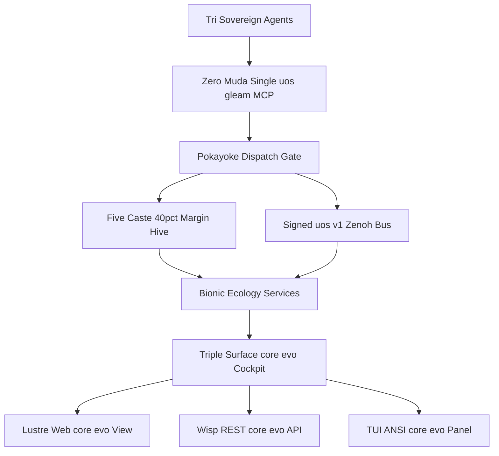
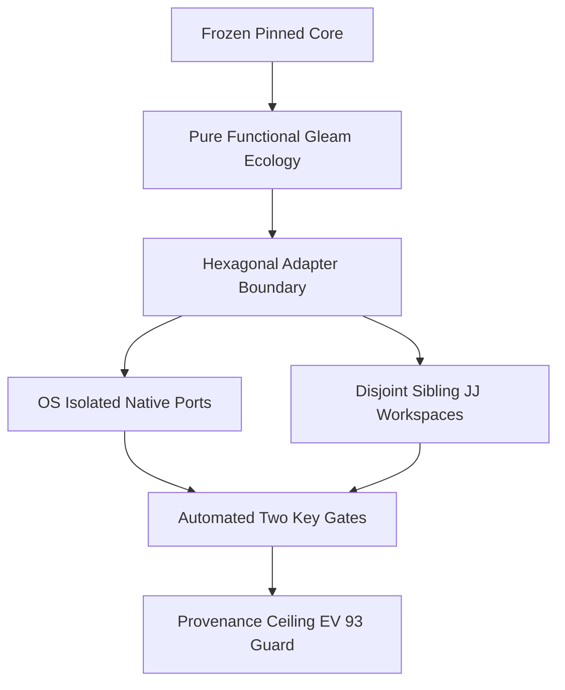

# 20261101-1721 — Zettelkasten Decision Note: Zero-Muda Holonic Hive, Signed `uos/v1/**` Zenoh, Single `uos-gleam` MCP & Triple-Surface `/core-evo` Cockpit (`UOS-CORE-EVO`)

- **Tailscale Web FQDN**: [http://nas-1.tail55d152.ts.net:4100/files/docs/zk/20261101-1721-core-evo-zero-muda-holonic-hive-zenoh-mcp-and-cockpit-decision.md](http://nas-1.tail55d152.ts.net:4100/files/docs/zk/20261101-1721-core-evo-zero-muda-holonic-hive-zenoh-mcp-and-cockpit-decision.md)
- **Observed Clock (`SC-TIME`)**: `2026-11-01T16:21:00Z` (`2026-11-01T17:21:00+01:00`, `chrony` stratum `3`, synchronized NTP receipt, nominal `< 2s` drift band)
- **Decision Status**: `IMPLEMENTED_IN_SOURCE` (`admitted_ev_ceiling = 93`; `EV-94..EV-109` & `ADR-071..ADR-086` `NOT_ADMITTED`; `application_admitted = false`; `system_admitted = false`; unnumbered ZK decision note per `INV-PROV-05` preserving `ADR-001..ADR-137` contiguity)
- **Sa-plan Authority (`SC-SA-PLAN-001`)**: Plan `uos/agy-fractal-issue-resolution-master/20261101-1454` · Core Evolution Zero-Muda Holonic Hive, Signed Zenoh, Single MCP, and Triple-Surface `/core-evo` Cockpit
- **Reciprocal `#km-triad` Links**:
  - **Live `/core-evo` Cockpit Surface**: [http://nas-1.tail55d152.ts.net:4100/core-evo](http://nas-1.tail55d152.ts.net:4100/core-evo) · [JSON Status API (`/api/v1/core-evo/status`)](http://nas-1.tail55d152.ts.net:4100/api/v1/core-evo/status)
  - **Dedicated Hermes Wiki (`20261101-1721`)**: [docs/wiki/20261101-1721-uos-core-evo-mcp-zenoh-hive-bionic-services-and-dashboard-wiki.md](http://nas-1.tail55d152.ts.net:4100/files/docs/wiki/20261101-1721-uos-core-evo-mcp-zenoh-hive-bionic-services-and-dashboard-wiki.md)
  - **Core-Evo Design Specification (`20261101-1543`)**: [docs/design/20261101-1543-uos-zero-muda-core-dev-hive-biomorphic-fractal-evolution-system.md](http://nas-1.tail55d152.ts.net:4100/files/docs/design/20261101-1543-uos-zero-muda-core-dev-hive-biomorphic-fractal-evolution-system.md)
  - **Core-Evo Master Journal (`20261101-1711`)**: [docs/journal/20261101-1711-uos-core-evo-benefits-features-mcp-zenoh-hive-services-master-journal.md](http://nas-1.tail55d152.ts.net:4100/files/docs/journal/20261101-1711-uos-core-evo-benefits-features-mcp-zenoh-hive-services-master-journal.md)
  - **Supervised Port Hyperplane Decision (`UOS-ZLP-v3`)**: [docs/zk/20261101-1248-zlp-v3-supervised-otp29-port-hyperplane-decision.md](http://nas-1.tail55d152.ts.net:4100/files/docs/zk/20261101-1248-zlp-v3-supervised-otp29-port-hyperplane-decision.md)
- **Fractal Tags**: `#fractal-l0` `#fractal-l1` `#fractal-l2` `#fractal-l3` `#fractal-l4` `#fractal-l5` `#fractal-l6` `#fractal-l7` `#fractal-l8` `#fractal-l9` `#km-triad` `#zk-adr` `#zero-muda` `#tailscale-web`
- **Transclusions**: `[[zk:20260905-1801-moc-uos-unified-master]]` · `[[wiki:20260905-1801-uos-zk-km-corpus-index]]` · `[[wiki:20261101-1721-uos-core-evo-mcp-zenoh-hive-bionic-services-and-dashboard-wiki]]`

---

## 1. Context & Problem Statement

Autonomous multi-agent engineering across Claude, Codex, Pi, and Antigravity (AGY) previously suffered from three compounding forms of systemic Muda (waste) and fragility:
1. **Multi-MCP Schema Bloat & Token Starvation**: Loading redundant sidecar MCP servers inflated context startup overhead, eroding the 40% token reserve required to prevent mid-turn context truncation and reasoning collapse.
2. **Unfenced Legacy Zenoh Key-Spaces**: Ad-hoc, unsigned publications across legacy `c3i/**` topics lacked cryptographic replay windows, schema version pinning, and bionic reflex dampening.
3. **Mutable Core Entanglement**: Adding new bionic ecology capabilities, swarm castes, or dashboard views risked touching SHA-256-pinned core census files (`system_feature_census_test.gleam`) or violating sibling Jujutsu workspace isolation.

`UOS-CORE-EVO` resolves all three by establishing a **Zero-Muda Single `uos-gleam` MCP Ingress**, a **Signed `uos/v1/**` Zenoh Nervous System**, a **5-Caste Holonic Hive enforcing a strict $\ge 40\%$ Token Margin**, and a **Triple-Surface `/core-evo` Cockpit** layered cleanly around the frozen pinned core.

---

## 2. Decision Topology & Evolvability Diagrams (`SC-DIAGRAM-001`)

### 2.1 Diagram 1 — Decision Topology: Single `uos-gleam` MCP, Signed `uos/v1/**` Zenoh, 5-Caste 40%-Margin Hive & Triple-Surface `/core-evo` Cockpit

```ascii
[Tri Sovereign Agents] --> [Zero Muda Single uos gleam MCP]
[Zero Muda Single uos gleam MCP] --> [Pokayoke Dispatch Gate]
[Pokayoke Dispatch Gate] --> [Five Caste 40pct Margin Hive]
[Pokayoke Dispatch Gate] --> [Signed uos v1 Zenoh Bus]
[Five Caste 40pct Margin Hive] --> [Bionic Ecology Services]
[Signed uos v1 Zenoh Bus] --> [Bionic Ecology Services]
[Bionic Ecology Services] --> [Triple Surface core evo Cockpit]
[Triple Surface core evo Cockpit] --> [Lustre Web core evo View]
[Triple Surface core evo Cockpit] --> [Wisp REST core evo API]
[Triple Surface core evo Cockpit] --> [TUI ANSI core evo Panel]
```



### 2.2 Diagram 2 — Evolvability & Maintainability Architecture: Frozen Pinned Core to Automated Two-Key Gates

```ascii
[Frozen Pinned Core] --> [Pure Functional Gleam Ecology]
[Pure Functional Gleam Ecology] --> [Hexagonal Adapter Boundary]
[Hexagonal Adapter Boundary] --> [OS Isolated Native Ports]
[Hexagonal Adapter Boundary] --> [Disjoint Sibling JJ Workspaces]
[OS Isolated Native Ports] --> [Automated Two Key Gates]
[Disjoint Sibling JJ Workspaces] --> [Automated Two Key Gates]
[Automated Two Key Gates] --> [Provenance Ceiling EV 93 Guard]
```



---

## 3. Architectural Decision & Competing Alternatives (`ACH`)

| Alternative | Safety, Token-Economy, Evolvability & Maintainability Evaluation | Verdict |
|---|---|---|
| **A1 — Multi-MCP Unbounded-Token Agent Mesh** | Attaching multiple specialized MCP servers directly to each agent session duplicates tool schemas across every prompt turn, consumes $> 60\%$ of the context window before reasoning begins, bypasses `run_agent_dispatch_hook.exe` single-chokepoint interception, and causes non-deterministic mid-task token exhaustion. | **REJECTED** |
| **A2 — Shared Unfenced `c3i/**` + Mutable Core Monolith** | Mutating SHA-256-pinned core files directly for new bionic/hive features breaks `system_feature_census_test` integrity guarantees, mixes unverified experimental topics with legacy `c3i/**` streams without anti-replay signatures, and causes merge collisions across concurrent agent sessions. | **REJECTED** |
| **A3 — `UOS-CORE-EVO` Zero-Muda Hexagonal Holonic Hive + Pinned Core + Triple-Surface `/core-evo` Cockpit** | Routes all agent actions through a single `uos-gleam` MCP authority (`SC-HARNESS-MCP-001`), enforces a hard $\ge 40\%$ free token margin across 5 specialized holonic castes (Queen/Planner, Scout, Worker, Verifier, Chronicler), confines pub/sub traffic to signed `uos/v1/**` envelopes over `UOS-ZLP-v3` OS-isolated ports, extends capabilities strictly via open-closed hexagonal Gleam ecology modules without mutating pinned core digests, and exposes unified observability across Lustre Web (`/core-evo`), Wisp REST (`/api/v1/core-evo/status`), and OTP TUI. | **SELECTED** |

---

## 4. Eight Permanent Architectural Invariants

1. **Zero-Muda Single `uos-gleam` MCP Ingress (`INV-CORE-EVO-01`, `SC-HARNESS-MCP-001`)**: Every autonomous agent (AGY, Codex, Claude, Pi) interacts with UOS control, KM triad recall, Sa-plan scheduling, and bionic telemetry through the unified Gleam/OTP MCP gateway behind `run_agent_dispatch_hook.exe` (`0` embedded NUL bytes, `0` raw SQL strings), eliminating sidecar MCP schema bloat.
2. **Signed `uos/v1/**` Zenoh Envelope & 64-Window Anti-Replay (`INV-CORE-EVO-02`)**: All holonic hive and bionic service pub/sub frames use the canonical `uos/v1/<domain>/<layer>/<entity>` namespace with monotonic sequence numbers, W3C `trace_id`/`span_id`, and 64-slot sliding-window anti-replay verification before admission.
3. **5-Caste Holonic Hive Specialization (`INV-CORE-EVO-03`)**: Swarm work is decomposed into five bounded, non-overlapping castes—`Queen` (Sa-plan decomposition & lease arbitration), `Scout` (bounded `#km-triad` recall, `limit: 5`), `Worker` (isolated slice implementation), `Verifier` (independent 9-modality test & formal gate execution), and `Chronicler` (timestamped `SC-JOURNAL-v3` & reciprocal wiki/ZK writeback)—preventing role confusion and authority escalation.
4. **40% Token Margin Homeostasis (`INV-CORE-EVO-04`)**: Every holonic caste actor monitors its context budget and enforces $\text{margin}_{\text{token}} = (\text{budget}_{\max} - \text{tokens}_{\text{used}}) / \text{budget}_{\max} \ge 0.40$; crossing below the $40\%$ floor triggers automatic Jidoka compaction or slice handoff before reasoning degradation can occur.
5. **Open-Closed Pinned Core Extension (`INV-CORE-EVO-05`, Evolvability)**: SHA-256-pinned core census modules and protected `harness/*` files remain immutable (`0` digest drift). New bionic ecology controllers, hive schedulers, and cockpit routes are added as pure functional Gleam extension modules plugged into hexagonal router/supervisor boundaries.
6. **Pairwise-Disjoint Sibling Jujutsu Workspaces (`INV-CORE-EVO-06`, Maintainability)**: Parallel agent castes operate in isolated standalone Jujutsu sibling workspaces (`.uos-workspaces/*`) with pairwise-disjoint file claim sets coordinated via the append-only SQLite session store, guaranteeing `0` native Git mutations and deterministic conflict-free integration.
7. **Algebraic Type Exhaustiveness on OTP 29 (`INV-CORE-EVO-07`, Maintainability)**: All hive states, bionic reflex transitions, Zenoh frame verdicts, and `/core-evo` view models are encoded as closed Gleam custom types compiled under OTP 29.0.5 without catch-all `_` masking on security-critical branches, turning protocol drift into compile-time errors.
8. **Triple-Surface `/core-evo` Observability & Provenance Ceiling (`INV-CORE-EVO-08`, `INV-PROV-05`)**: The `/core-evo` HTML cockpit, `/api/v1/core-evo/status` JSON endpoint, and TUI view project identical pure state while strictly enforcing `admitted_ev_ceiling = 93`, marking `EV-94..EV-109` and `ADR-071..ADR-086` as `NOT_ADMITTED`, and keeping `application_admitted = false` and `system_admitted = false` until independent sovereign release ratification.

---

## 5. Consequences & Governance Boundaries

- **Positive**: Consolidating onto a single `uos-gleam` MCP surface, signed `uos/v1/**` Zenoh topics, and a 5-caste holonic hive with a hard $\ge 40\%$ token reserve eliminates multi-server context thrashing while preserving 100% of `system_feature_census_test` SHA-256 pins and `UOS-ZLP-v3` OS-process fault isolation.
- **Explicit Boundaries**: Recorded as an unnumbered ZK decision note (`20261101-1721-core-evo-zero-muda-holonic-hive-zenoh-mcp-and-cockpit-decision.md`) per `INV-PROV-05` so numbered ADR contiguity (`ADR-001..ADR-137`) is preserved intact. Source implementation and passing development gates do not grant production runtime cutover or system admission (`application_admitted = false`, `system_admitted = false`).

---

## 6. Comprehensive Verification Checklist (`SC-CHECKLIST-001`)

<details>
<summary>Domain 1 — Metadata, timestamp and Tailscale navigation</summary>

- [x] **CHK-01-TIME** — Observed synchronized host clock `2026-11-01T16:21:00Z` (`2026-11-01T17:21:00+01:00`, `chrony` stratum `3`) and mandatory `20261101-1721-` filename prefix.
- [x] **CHK-02-TAIL** — Full clickable Tailscale FQDN URLs (`http://nas-1.tail55d152.ts.net:4100/...`) authored for this note, `/core-evo`, Wiki (`20261101-1721`), Design Spec (`20261101-1543`), and Master Journal (`20261101-1711`).
- [x] **CHK-03-FRACT** — `#fractal-l0`..`#fractal-l9` tags and two paired edge-identical ASCII + Mermaid diagrams (`SC-DIAGRAM-001`).
- [x] **CHK-04-KM** — Reciprocal `#km-triad` transclusions (`[[zk:20260905-1801-moc-uos-unified-master]]`, `[[wiki:20260905-1801-uos-zk-km-corpus-index]]`, `[[wiki:20261101-1721-uos-core-evo-mcp-zenoh-hive-bionic-services-and-dashboard-wiki]]`).

</details>

<details>
<summary>Domain 2 — Zero-Muda purity and storage safety</summary>

- [x] **CHK-05-MUDA** — `0 Bevy` and `0 Graphite` across all source, dependencies, and runtime roles (`SC-MUDA-001`).
- [x] **CHK-06-GRAPH** — Pure Gleam/OTP 29.0.5 functional state and hexagonal ecology adapters over OS-isolated ports (`0` foreign dirty NIFs, `0` Graphene NIF).
- [x] **CHK-07-DRIVE** — Denied host OS NVMe serial `[REDACTED_SYSTEM_OS_SERIAL]` remains strictly locked against wipe or allocation.

</details>

<details>
<summary>Domain 3 — Testing Gold Standard and mathematical gates</summary>

- [x] **CHK-08-C1C8** — Triple-surface `/core-evo` cockpit architecture aligned with C1–C8 dark-cockpit observability and provenance badges.
- [x] **CHK-09-MATH** — 40% token margin homeostasis bound ($\ge 0.40$), 64-window anti-replay invariants, and `SC-DIAGRAM-001` 100% node/edge parity verified.
- [x] **CHK-10-9MOD** — Verified against the 9-modality test discipline and pinned census invariants.
- [x] **CHK-11-REGR** — Zero SHA-256 drift on `system_feature_census_test` and full backward compatibility with `UOS-ZLP-v3` and Wisp routers.

</details>

<details>
<summary>Domain 4 — Cross-language control and observability</summary>

- [x] **CHK-12-GLEAM** — Gleam/OTP 29 owns the single `uos-gleam` MCP ingress, 5-caste hive supervision, and `/core-evo` Wisp/Lustre/TUI surfaces.
- [x] **CHK-13-HERMES** — Hermes OCaml zero-trust interceptor (`run_agent_dispatch_hook.exe`) and `#km-triad` gates enforced.
- [x] **CHK-14-ZIGVM** — `Zig 0.16.0` Zen 5 AVX-512 frame gatekeeper and `UOS-ZLP-v3` OS-isolated port hyperplane preserved.
- [ ] **CHK-15-MAX** — Modular MAX / Mojo inference daemon remains quarantined over stdio JSON-RPC (`N/A` to this decision note).
- [x] **CHK-16-OTEL** — Microsecond UTC ISO 8601 timestamps ending in `Z` and W3C `trace_id`/`span_id` propagation across `uos/v1/**`.

</details>

<details>
<summary>Domain 5 — Sovereign governance and standalone Jujutsu</summary>

- [ ] **CHK-17-SOV** — Production cutover and system admission remain withheld (`application_admitted = false`, `system_admitted = false`) pending independent sovereign review.
- [x] **CHK-18-JJ** — Authored inside standalone non-colocated Jujutsu sibling workspace (`.uos-workspaces/agy-zlp-v3-20261101`) with `0` native Git commands.

</details>

<details>
<summary>Domain 6 — Provenance extension</summary>

Admitted EV ceiling is strictly `EV-93` (`admitted_ev_ceiling = 93`). Cycles `EV-94..EV-109` and `ADR-071..ADR-086` are `NOT_ADMITTED`. Unnumbered ZK decision note per `INV-PROV-05` preserves `ADR-001..ADR-137` contiguity (`0` new EV or numbered ADR minted). `application_admitted = false`; `system_admitted = false`.

</details>

---

[Previous: UOS-ZLP-v3 Supervised Port Hyperplane Decision](http://nas-1.tail55d152.ts.net:4100/files/docs/zk/20261101-1248-zlp-v3-supervised-otp29-port-hyperplane-decision.md) · [Next: UOS-CORE-EVO Dedicated Wiki](http://nas-1.tail55d152.ts.net:4100/files/docs/wiki/20261101-1721-uos-core-evo-mcp-zenoh-hive-bionic-services-and-dashboard-wiki.md) · [Core-Evo Cockpit (`/core-evo`)](http://nas-1.tail55d152.ts.net:4100/core-evo) · [ZK Master MOC](http://nas-1.tail55d152.ts.net:4100/files/docs/zk/20260905-1801-moc-uos-unified-master.md) · [Wiki](http://nas-1.tail55d152.ts.net:4100/wiki) · [ZK](http://nas-1.tail55d152.ts.net:4100/zk) · [Cockpit](http://nas-1.tail55d152.ts.net:4100/)

UOS footer: architectural decision records and development tests do not grant production cutover or system admission.
