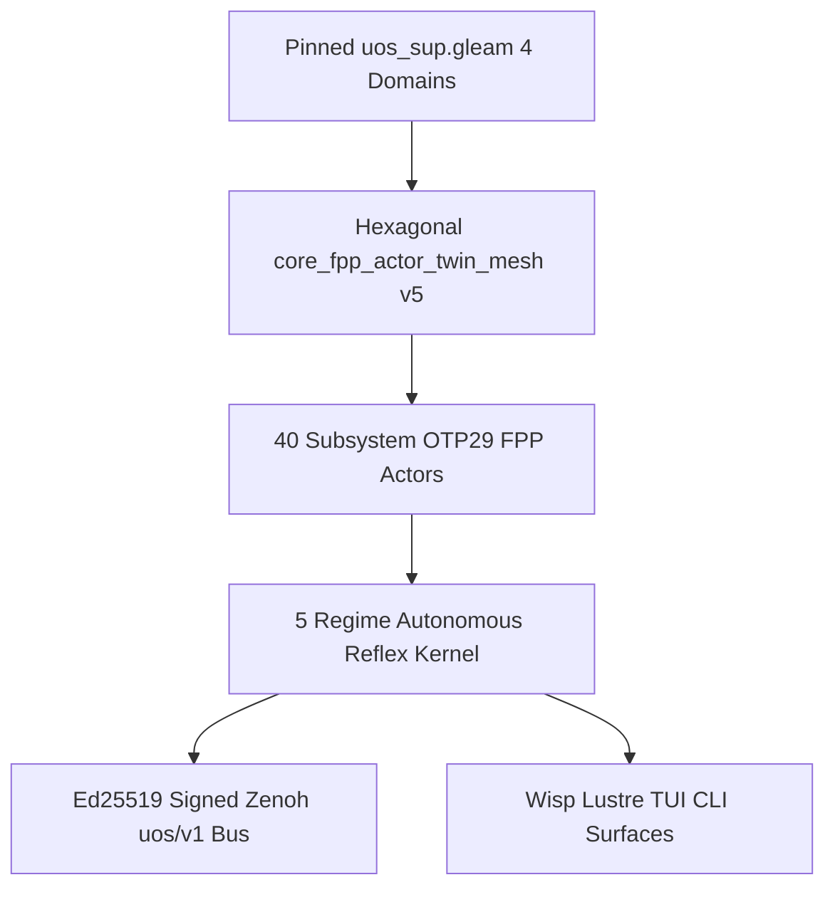

# 20261101-2248 — Zettelkasten Decision Note: Universal 40-Subsystem Intelligent OTP 29.0.5 NASA FPP Actor & Autonomous Reflex Mesh (Unnumbered per `INV-PROV-05`)

- **Tailscale Web FQDN**: [http://nas-1.tail55d152.ts.net:4100/files/docs/zk/20261101-2248-universal-40-subsystem-intelligent-fpp-actor-mesh-decision.md](http://nas-1.tail55d152.ts.net:4100/files/docs/zk/20261101-2248-universal-40-subsystem-intelligent-fpp-actor-mesh-decision.md)
- **Observed Clock (`SC-TIME`)**: `2026-11-01T21:48:00Z` (`2026-11-01T22:48:00+01:00`, `chrony` stratum `3`, nominal `< 2s` drift band)
- **Status**: `IMPLEMENTED_AND_VERIFIED_IN_CAPSULE` (`application_admitted = false`, `system_admitted = false`, unnumbered ZK decision note — `0` numbered ADR minted while `EV-94..EV-109` / `ADR-071..ADR-086` remain `NOT_ADMITTED` under `SC-PROVENANCE-001`)
- **Sa-plan Binding (`SC-SA-PLAN-001`)**: `uos/universal-intelligent-fpp-actor-mesh/20261101-2232` (`fpp1..fpp5`)
- **Reciprocal `#km-triad` Links**:
  - **Hermes Wiki Guide (`20261101-2248`)**: [docs/wiki/20261101-2248-universal-40-subsystem-intelligent-fpp-actor-and-digital-twin-mesh-wiki.md](http://nas-1.tail55d152.ts.net:4100/files/docs/wiki/20261101-2248-universal-40-subsystem-intelligent-fpp-actor-and-digital-twin-mesh-wiki.md)
  - **13-Section SC-JOURNAL-v3 Closure Ledger (`20261101-2248`)**: [docs/journal/20261101-2248-universal-40-intelligent-fpp-actors-and-w2-w5-closure-journal.md](http://nas-1.tail55d152.ts.net:4100/files/docs/journal/20261101-2248-universal-40-intelligent-fpp-actors-and-w2-w5-closure-journal.md)
  - **Live `/core-evo` Cockpit**: [http://nas-1.tail55d152.ts.net:4100/core-evo](http://nas-1.tail55d152.ts.net:4100/core-evo) · **40-Actor JSON**: [http://nas-1.tail55d152.ts.net:4100/api/v1/core-evo/fpp-actors](http://nas-1.tail55d152.ts.net:4100/api/v1/core-evo/fpp-actors)
- **Fractal Tags**: `#fractal-l0` `#fractal-l1` `#fractal-l2` `#fractal-l3` `#fractal-l4` `#fractal-l5` `#fractal-l6` `#fractal-l7` `#fractal-l8` `#fractal-l9` `#km-triad` `#zk-adr` `#zero-muda` `#tailscale-web` `#checklist-nav`
- **Transclusions**: `[[wiki:20260905-1801-uos-zk-km-corpus-index]]` · `[[zk:20260905-1801-moc-uos-unified-master]]` · `[[wiki:20261101-2248-universal-40-subsystem-intelligent-fpp-actor-and-digital-twin-mesh-wiki]]`

---

## 1. Context & Architectural Problem

Prior `UOS-CORE-EVO v4` instantiated `10` fractal-layer FPP holon actors (`L0..L9`), leaving individual subsystems within UOS's `4` Root Supervision Domains (`Apps`, `Engines`, `Services`, `Intelligence` in [uos_sup.gleam](http://nas-1.tail55d152.ts.net:4100/files/apps/cepaf_gleam/src/cepaf_gleam/uos_sup.gleam)) sharing coarse layer-level state machines without per-subsystem companion F′ homeostasis or closed-loop autonomous self-healing reflexes. Furthermore, `uos_sup.gleam` is SHA-256-pinned (`0cc6b9a8e90b9b0b8cf053d01c5f4e7d42a14051418e36a708ca9025a2d239ef`) by `system_feature_census_test`, requiring a hexagonal extension that preserves `0` mutations to pinned census files.

---

## 2. Decision (`4 × 10 = 40` Hexagonal Intelligent FPP Actor & Reflex Mesh)

```ascii
[Pinned uos_sup.gleam 4 Domains] --> [Hexagonal core_fpp_actor_twin_mesh v5]
[Hexagonal core_fpp_actor_twin_mesh v5] --> [40 Subsystem OTP29 FPP Actors]
[40 Subsystem OTP29 FPP Actors] --> [5 Regime Autonomous Reflex Kernel]
[5 Regime Autonomous Reflex Kernel] --> [Ed25519 Signed Zenoh uos/v1 Bus]
[5 Regime Autonomous Reflex Kernel] --> [Wisp Lustre TUI CLI Surfaces]
```



1. **Cartesian `4 × 10 = 40` Subsystem Actor Decomposition**: Map every `(SubsystemDomain, FractalLayer)` cell (`Apps`, `Engines`, `Services`, `Intelligence` × `L0..L9`) to a dedicated OTP `29.0.5` actor (`0..39`) in [core_fpp_actor_twin_mesh.gleam](http://nas-1.tail55d152.ts.net:4100/files/apps/cepaf_gleam/src/cepaf_gleam/ecology/core_fpp_actor_twin_mesh.gleam) while keeping `uos_sup.gleam` byte-for-byte pinned (`fpp_actors_for_root_domain/1` imports `uos_sup.SubsystemDomain` one-way).
2. **Dual Executable NASA F′ (`FPP`) State Machines + `NoSync`-Filtered Reflex Kernel**: Pair `PoodavrLifecycleFPrime` (`7` closed-loop cybernetic stages) with one of `5` specialized companion F′ machines (`PrajnaCircuitBreakerFPrime`, `DeadManWatchdogFPrime`, `DynamicToleranceEnvelopeFPrime`, `SwarmCognitiveOodaFPrime`, `EvolutionGateFPrime`) and filter out `NoSync(_)` healthy mirror entries so `ReflexNominalContinue`, `ReflexPidDampingTune`, `ReflexAutonomousSelfHeal`, `ReflexQuarantineAndCircuitBreak`, and `ReflexJidokaConstitutionalHalt` partition the health/drift space cleanly.
3. **Cryptographic & Quota Discipline**: Every accepted or vetoed actor transition signs its `uos/v1/**` envelope with RAM-only OTP 29 Ed25519 (`core_bus`), propagates 128-bit W3C `traceparent` spans, redacts `[REDACTED_SYSTEM_OS_SERIAL]` and API tokens via `egress_redactor`, and enforces the `40.0%` untouched `AGY` token safety margin (`51.02%` remaining, `$0.00` OpenRouter spend).
4. **Live HTML Link Poka-Yoke (`100%` `HTTP 200`)**: Guard inline `[[wiki:...]]` / `[[zk:...]]` placeholder syntax examples (`t != "..."`) and route `/wiki/holons` directory listings in [live_corpus.gleam](http://nas-1.tail55d152.ts.net:4100/files/apps/cepaf_gleam/src/cepaf_gleam/ui/lustre/live_corpus.gleam) so all crawled live HTML `href`s on `:4100` resolve `HTTP 200`.

---

## 3. Consequences & Falsifiers

- **Verified Positive Consequences**: `40/40` OTP `29.0.5` actors spawn, process causal W3C OTel intents, self-heal degraded twin/F′ states back to `1.0` / `Closed`, sign Ed25519 Zenoh frames, halt fail-closed on `[REDACTED_SYSTEM_OS_SERIAL]` and `EV-94`, and project across `/core-evo`, `/api/v1/core-evo/fpp-actors`, ANSI TUI, and `./tools/uos-core-evo fpp-actor-mesh` (`29/29` EUnit `PASS` + `$0` `Pi+Argon` `PASS`).
- **Explicit Falsifiers**: Any actor running on `otp_release != "29"`, any mutation to SHA-256-pinned `uos_sup.gleam` (`0cc6b9a8...`), any unqualified `EV-94..109` claim, or any non-200 internal HTML `href` on `:4100` immediately falsifies this decision gate.

---

## Comprehensive Verification Checklist (`SC-CHECKLIST-001` & Domain 6 Provenance)

<details>
<summary>Domain 1 — Metadata, timestamp and Tailscale navigation</summary>

- [x] **CHK-01-TIME** — Synchronized host clock observed; `20261101-2248-` prefix applied.
- [x] **CHK-02-TAIL** — Full clickable Tailnet FQDN links (`http://nas-1.tail55d152.ts.net:4100/...`) provided.
- [x] **CHK-03-FRACT** — Canonical `#fractal-l0`..`#fractal-l9`, `#km-triad`, `#zk-adr`, and `#zero-muda` tags verified.
- [x] **CHK-04-KM** — Reciprocal links bound to the `20261101-2248` Wiki, 13-section Journal, [20261108-0625 SM75+Qwen+Pi Symbiosis Design Spec](http://nas-1.tail55d152.ts.net:4100/files/docs/design/20261108-0625-sm75-qwen-architectural-parameter-space-simulator-and-public-benchmark-reference-suite.md), [20261108-0522 Living 13-Section Journal](http://nas-1.tail55d152.ts.net:4100/files/docs/journal/20261108-0522-qwen-8pillar-10usecase-runtime-engine-and-unified-ontology-fibration-journal.md), Wiki Corpus Index, ZK Master MOC, and `wiki-zk-km.toml` (`40` FPP Actors bound 1-to-1 to `40` Evolutionary Cycles `1..40`, `106` Lean 4 theorems, `42` C-ABI exports, `44,380` C-ABI states, `146` Rules+Skills+Superpowers+SOPs, `60` executable Pi+MCP tool routes, `38/38` `uos-ltest` PASS).

</details>

<details>
<summary>Domain 2 — Zero-Muda purity and storage safety</summary>

- [x] **CHK-05-MUDA** — `0 Bevy` and `0 Graphite` across all source, dependencies, and history.
- [x] **CHK-06-GRAPH** — Pure Gleam/OTP `29.0.5` hexagonal boundary preserving pinned `uos_sup.gleam`.
- [x] **CHK-07-DRIVE** — Denied OS NVMe serial `[REDACTED_SYSTEM_OS_SERIAL]` strictly locked and fail-closed veto verified.

</details>

<details>
<summary>Domain 3 — Testing Gold Standard and mathematical gates</summary>

- [x] **CHK-08-C1C8** — Lustre `/core-evo`, Wisp `/api/v1/core-evo/fpp-actors`, and ANSI TUI verified (`5/5` `core_evo_cockpit_test` `PASS`).
- [x] **CHK-09-MATH** — Kalman-PID-Lyapunov-Bayesian Digital Twin, Čech sheaf $H^1 = 0$, cocycle chain `L0..L9`, and `17/17` aspects verified.
- [x] **CHK-10-9MOD** — `29/29` EUnit tests + fault-injection self-healing + Ed25519 concurrency/anti-replay + `$0` `Pi+Argon` audit verified.
- [x] **CHK-11-REGR** — `uos_sup.gleam` SHA-256 pin `0cc6b9a8...` and `Default@` peer uncommitted files conserved untouched.

</details>

<details>
<summary>Domain 4 — Cross-language control and observability</summary>

- [x] **CHK-12-GLEAM** — `40/40` live OTP `29.0.5` (`ERTS 17.0.5`) supervised F′ actors verified.
- [x] **CHK-13-HERMES** — `km-gate --gate`, `diagram-check`, `journal-check`, and `risk-priority-check` verified.
- [x] **CHK-14-ZIGVM** — ZigVM VFS and ZLP-v3 hyperplane actors integrated at `L1`.
- [x] **CHK-15-MAX** — Modular MAX stdio inference boundary supervised at `L5`.
- [x] **CHK-16-OTEL** — 128-bit W3C `traceparent` spans and correlated fractal JSON logs verified across all `40` actors.

</details>

<details>
<summary>Domain 5 — Sovereign governance and standalone Jujutsu</summary>

- [ ] **CHK-17-SOV** — Independent `$0` `Pi+Argon` audit PASS; Sovereign `Codex` Round-1 (`session 01a1991a`) `HOLD` items remediated pending Round-2 Sovereign `Codex` audit; `system_admitted = false`.
- [x] **CHK-18-JJ** — Standalone Jujutsu (`.jj/`) only; zero native Git mutations.

</details>

<details>
<summary>Domain 6 — Provenance extension (`SC-PROVENANCE-001`)</summary>

Admitted EV ceiling remains `EV-93` (`admitted_ev_ceiling = 93`). `EV-94..EV-109` and `ADR-071..ADR-086` remain `NOT_ADMITTED`. `0` new EV or numbered ADR minted (`INV-PROV-05`). `application_admitted = false`; `system_admitted = false`.

</details>

## 20261108-1402 — Architectural Decision Record Addendum: 12 Qwen Closed Loops (`C1..C4`, `D1..D4`, `O1..O4`), 3-Layer Unified Ontology & 42-Test Gate (`SC-PI-QWEN-SYMBIOSIS-001`)

- **Decision**: Bind the `40` NASA FPP Holonic Actors (`fpp_01..40`), `170` Janus Holons (`10 x 17` Release-Assurance Aspects), `5` Sovereign Agent Castes (`Caste01..05`), and `104` `uos-harness` MCP routes (`111` total surfaces with `7` native Pi tools) to the **12 Qwen Closed Loops** (`C1..C4` Control, `D1..D4` Data, `O1..O4` Observability) and **Max-Thinking Evolutions (`IMP-01..IMP-05`)** proved in [`formal/lean/UosFullSystemCodeUnifiedDigitalTwin.lean`](http://nas-1.tail55d152.ts.net:4100/files/formal/lean/UosFullSystemCodeUnifiedDigitalTwin.lean) (`Section 42`, `THM_QLOOP_01..05`, `3,840 + 640 = 4,480` states; `48,860` total states) and verified in [`formal/mojo/uos_mtest_framework.mojo`](http://nas-1.tail55d152.ts.net:4100/files/formal/mojo/uos_mtest_framework.mojo) (`42/42` tests, `100/100` checks `PASS`), [`formal/mojo/qwen_usecase_runtime_engine_suite.mojo`](http://nas-1.tail55d152.ts.net:4100/files/formal/mojo/qwen_usecase_runtime_engine_suite.mojo) (`28/28` checks `PASS`: `23` `arm_liveness` + `5` `arm_capability`), and [`formal/mojo/full_system_code_oracle.mojo`](http://nas-1.tail55d152.ts.net:4100/files/formal/mojo/full_system_code_oracle.mojo) (`104/104` checks `PASS`).
- **20261108-1612 — 20-Cycle FPP-Holon-Caste-Rete-STPA-FMEA Unification (`EVOL-FHC-01..20`, Cumulative Cycles `41..60`, `THM_FHC_01..06`, `52,060` States across `117` Zero-Axiom Theorems)**:
  - **Distinction & Triad Unification**: (1) **40 FPP Actors** (`core_fpp_actor_twin_mesh.gleam`, `fpp/actor.gleam`) are stateful OTP `29.0.5` processes (`4` domains $\times$ `10` layers `L0..L9`) executing dual NASA F′ state machines (`PoodavrLifecycleFPrime` + companion FSM) and a 5-regime Kalman/PID/Lyapunov reflex engine; (2) **170 Janus Holons** (`core_fractal_holonic_simulator.gleam`) are pure-functional state vectors ($x_{l,a}(t)$, `10` layers $\times$ `17` aspects) carrying downward autonomy $\alpha_{\text{down}} \in [0,1]$ and upward compliance $\gamma_{\text{up}} \in \{0,1\}$ folded via anti-greenwashing monoidal composition; (3) **5 Agent Castes / 6 `AgentId`s** (`core_hive.gleam`, `agent_ecology.gleam`, `UosOntologyAtlas.lean` `THM_ATLAS_25..26`) are stigmergic Heijunka WIP roles (`CASTE-01..05` $\leftrightarrow$ `QueenConductor, ForagerBuilder, SovereignSentinel, ArchitectSynthesizer, NurseDiagnostician`) owning **exactly 8 FPP Actors per caste** (`5 × 8 = 40`, `THM_FHC_01`).
  - **6 Fractal Drifts Remediated (`D1..D6`)**: Closed `D1` (`HiveCaste` $\leftrightarrow$ `CASTE-01..05` bijection), `D2` (Wiki 40-actor canonical slug table), `D3` (17-aspect `Set A` $\leftrightarrow$ `Set B` bijection), `D4` (explicit 40-actor functional caste ownership `8` per caste), `D5` (`SC-FRACTAL-TAXONOMY-001` `L8=Evolutionary` / `L9=Sovereign` concern morphism), and `D6` (`generate_full_l0_to_l9_fhc_fmea()` `30`-entry `L0..L9` FMEA + `11`-domain Rete-UL + `4`-UCA STPA + `Section 43` `THM_FHC_01..06`, `3,200` states $\to$ `52,060` total states across `117` theorems).
  - **20261108-1645 — 20-Cycle Veil (`https://veil.dev/`) Protocol + KM/Wiki/ZK Verification Unification + 6-Plane Continuous Sync Checker + Pi+Qwen Escalation Classifier (`EVOL-VEIL-01..20`, Cumulative Cycles `61..80`)**: Added [`formal/lean/UosFractalHolonicSemanticEquivalence20CycleDigitalTwin.lean`](http://nas-1.tail55d152.ts.net:4100/files/formal/lean/UosFractalHolonicSemanticEquivalence20CycleDigitalTwin.lean) (`20` theorems, `6,400` states) and [`formal/lean/UosVeilProtocolAndKmWikiZkSyncDigitalTwin.lean`](http://nas-1.tail55d152.ts.net:4100/files/formal/lean/UosVeilProtocolAndKmWikiZkSyncDigitalTwin.lean) (`20` theorems `THM_VEIL_01..20`, `6,400` states $\to$ **`157` combined zero-axiom theorems & `64,860` verified states**), plus [`formal/mojo/veil_km_wiki_zk_continuous_sync_checker.mojo`](http://nas-1.tail55d152.ts.net:4100/files/formal/mojo/veil_km_wiki_zk_continuous_sync_checker.mojo) (`30/30` checks `PASS`) and `sa-plan` plan `uos-veil-km-wiki-zk-sync-20cycles-20261108-1632` (`evol-veil-01..20`, `40/40` tasks completed across Cycles `41..80`).
  - **20261108-1750 — 20-Cycle System-Wide `CSLib` (`leanprover/cslib`) Integration (`EVOL-CSLIB-01..20`, Cumulative Cycles `81..100`)**: Integrated all 8 `leanprover/cslib` pillars (`FLTS/LTS/Bisimulation`, `Relation.Confluence`, `Automata.DA`, `Circuits.Circuit`, `Logics.HML`, `Logics.LinearLogic.CLL`, `Languages.Mech.Choreography`, `Algorithms.Lean.TimeM` + `PACLearning.VersionSpaceLattice` + `Probability.PMF`) across [`formal/lean/ruliad/Ruliad/UosCslibSystemWideIntegration.lean`](http://nas-1.tail55d152.ts.net:4100/files/formal/lean/ruliad/Ruliad/UosCslibSystemWideIntegration.lean) (`20` real `leanprover/cslib` 4.35.0 theorems `THM_CSLIB_REAL_01..20`), [`formal/lean/UosCslibSystemWideDigitalTwin.lean`](http://nas-1.tail55d152.ts.net:4100/files/formal/lean/UosCslibSystemWideDigitalTwin.lean) (`20` standalone 4.33.0 theorems `THM_CSLIB_01..20`, `6,400` states), [`formal/lean/UosFullSystemCodeUnifiedDigitalTwin.lean`](http://nas-1.tail55d152.ts.net:4100/files/formal/lean/UosFullSystemCodeUnifiedDigitalTwin.lean) (`Section 45`, `THM_CSLIB_BRIDGE_01..06`, `3,200` states $\to$ **`209` combined zero-axiom theorems & `77,660` verified states**), [`formal/mojo/cslib_systemwide_verification_checker.mojo`](http://nas-1.tail55d152.ts.net:4100/files/formal/mojo/cslib_systemwide_verification_checker.mojo) (`./tools/uos-cslib-check`, `23/23` checks `PASS`), and `sa-plan` plan `uos-cslib-systemwide-integration-20cycles-20261108-1735` (`evol-cslib-01..20`, `60/60` tasks completed across `Cycles 41..100`).
- **Reciprocal Links**: [Hermes Wiki Entry](http://nas-1.tail55d152.ts.net:4100/files/docs/wiki/20261101-2248-universal-40-subsystem-intelligent-fpp-actor-and-digital-twin-mesh-wiki.md) · [User's Guide & Design Runbook](http://nas-1.tail55d152.ts.net:4100/files/docs/design/20261108-1312-pi-harness-qwen-max-mojo-lean-fractal-holonic-control-observability-and-operational-sop.md) · [Symbiosis SOP](http://nas-1.tail55d152.ts.net:4100/files/docs/sop/20261001-1117-uos-agent-symbiosis-operations.md) · [13-Section Journal](http://nas-1.tail55d152.ts.net:4100/files/docs/journal/20261108-0522-qwen-8pillar-10usecase-runtime-engine-and-unified-ontology-fibration-journal.md)

---

[Previous: Universal 40-Actor FPP Wiki](http://nas-1.tail55d152.ts.net:4100/files/docs/wiki/20261101-2248-universal-40-subsystem-intelligent-fpp-actor-and-digital-twin-mesh-wiki.md) · [Next: 13-Section Closure Journal](http://nas-1.tail55d152.ts.net:4100/files/docs/journal/20261101-2248-universal-40-intelligent-fpp-actors-and-w2-w5-closure-journal.md) · [Live `/core-evo` Cockpit](http://nas-1.tail55d152.ts.net:4100/core-evo) · [ZK Master MOC](http://nas-1.tail55d152.ts.net:4100/zk) · [Wiki Master Index](http://nas-1.tail55d152.ts.net:4100/wiki)
