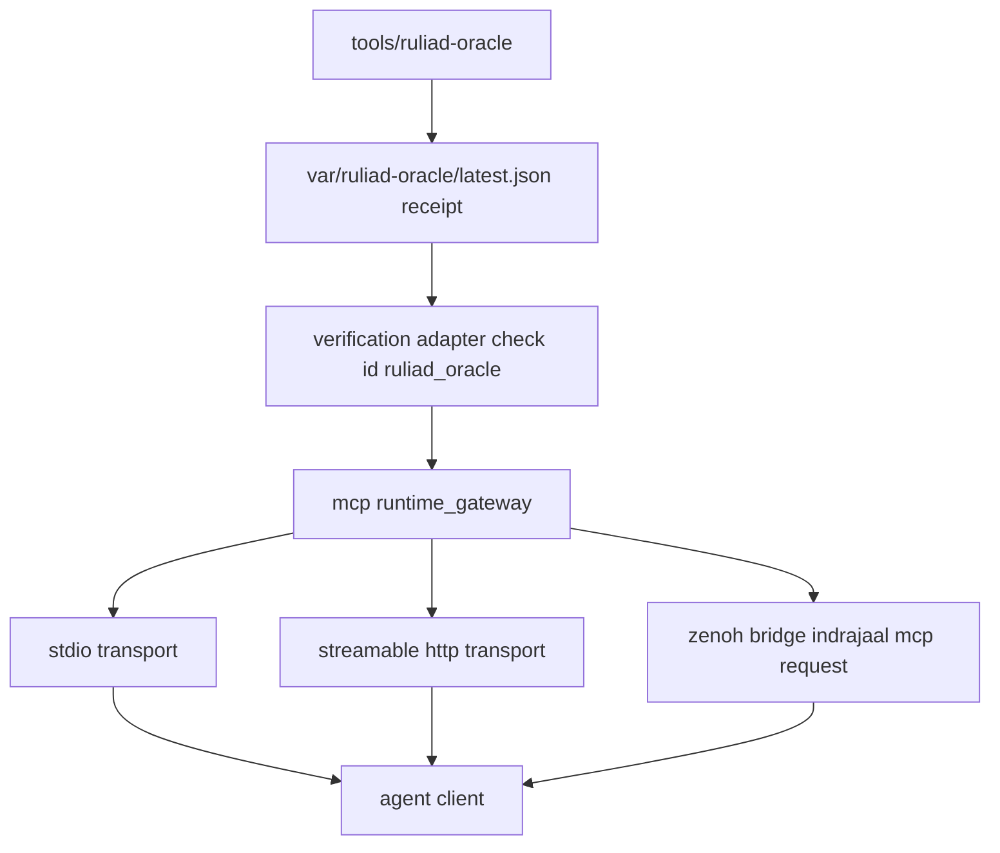

# 20261101-2031 — Model-to-source differential oracle

The Lean library in `formal/lean/ruliad/` claims to model deployed code. The
journal [20261101-1911](http://nas-1.tail55d152.ts.net:4100/files/docs/journal/20261101-1911-ruliad-formal-library-journal.md)
graded that claim **C3** on the Admiralty scale — hand transcription, line-cited,
nothing mechanically checked — and named this oracle as the way to raise it.

It runs **both** engines over one shared corpus and classifies every
disagreement. Not a test that the model is right; a measurement of where it is
not.

## Parts

| File | Role |
|---|---|
| `corpus.tsv` | Hand-written corpus, 23 cases. Unicode probes and all five bounds rejections. One source of truth read by both sides, so a transcription error cannot masquerade as agreement. |
| `gen_corpus.ml` | Deterministic generator (seeded LCG). `gen_corpus SEED COUNT`. Reproducible from `(seed, count)` alone, so a divergence replays exactly. Emits roughly one malformed input in eight, so the input guard's rejection paths are exercised and not only the happy path. |
| `service_corpus.tsv` | 19 cases for the merge classifier, probing `isDivergent` edges: case sensitivity, substring boundaries, both keywords at once, empty change, non-ASCII around the keyword. |
| `../RuliadDiff.lean` | Lean side, multiway. `lake exe ruliaddiff`. |
| `../ServiceDiff.lean` | Lean side, merge classifier. `lake exe servicediff`. Compares **decisions**, not raw floats: the deployed record carries `Float` and the model carries `ℚ`, so printed forms would differ by representation while agreeing in value. |
| `ruliad_diff.erl` | Gleam side, multiway. Calls the **deployed** `cepaf_gleam@ecology@multiway:explore/3` on the BEAM. |
| `service_diff.erl` | Gleam side. Calls the **deployed** `inference_api:evaluate_ruliad_branch/4` and `max_inference_daemon:is_ruliad_mergeable/1`. |
| `compare.ml` | OCaml classifier: `IDENTICAL` / `ORDER_ONLY` / `ALLOWED` / `DIVERGENT`. `--quiet`, `--allow FILE`. Exits 1 on any unlisted divergence. |
| `allow.txt` | Known, documented divergences, one case key per line, `#` comments. Keeps a modelling boundary visible instead of hiding it behind a threshold. |

Languages are not incidental: Erlang because the subject under test lives on the
BEAM, OCaml because that is the repository's helper language, Lean because the
model is Lean. No shell, Python or Node logic.

## Gate

```bash
tools/ruliad-oracle [--cases N] [--seed S]      # default 10000, seed 20261101
```

Three arms, JSON receipt on stdout, exit 1 on any unlisted divergence.
**Negative control performed**: with `allow.txt` emptied the gate exits 1,
reports `all_passed: false`, and names the diverging arm — so it can fail.

## Measured result

Hand corpus: **23 cases — 13 identical, 9 order-only, 1 allowed, 0 divergent.**

Generated, 5 independent seeds × 20,000: **100,000 cases — 0 divergent.**
Coverage of the generated corpus (per 10,000): 8,688 `OK`, 1,164 bounds
rejections, 148 exploration-budget rejections; mean 4.7 states per successful
case, max 64, 1,166 cases reaching ≥ 10 states.

Service corpus: **19 cases — 19 identical, 0 divergent.**

| Class | Finding | Status |
|---|---|---|
| Input bounds, bytes vs characters | The model used character length; the Gleam guard uses `string.byte_size`. On a 70-character, 140-byte seed the model returned `OK` where the engine refuses. | **FIXED** — `Multiway.byteSize` |
| List order | Gleam's `occurrences` prepends, so edges emerge in descending offset order; the model's `filterMap` over `List.range` is ascending. Edge and state *sets* agree. | **ACCEPTED** — no theorem depends on order |
| `Edge.offset` coordinates | Gleam walks with `pop_grapheme` (grapheme indices); the model indexes `List Char` (Unicode scalars). On `e`+U+0301 they read 1 and 2. Precomposed characters and astral-plane emoji agree, because there one grapheme is one scalar. | **NOT FIXED, ALLOWLISTED** — matching would mean implementing Unicode grapheme segmentation in Lean |

The first class is the one that mattered: the oracle found a case where the
model admits input the deployed engine refuses, and that is corrected in the
model rather than argued away.

## How UOS, MCP and Zenoh use this

The Lean library itself is **compile-time evidence**: proofs are discharged by
`lake build` and `tools/lean-offline-gate`, and nothing calls a theorem at
runtime. What the running system consumes is the oracle's **receipt**, through
the seam Gleam already owns.

```text
[tools/ruliad-oracle] --> [var/ruliad-oracle/latest.json receipt]
[var/ruliad-oracle/latest.json receipt] --> [verification adapter check id ruliad_oracle]
[verification adapter check id ruliad_oracle] --> [mcp runtime_gateway]
[mcp runtime_gateway] --> [stdio transport]
[mcp runtime_gateway] --> [streamable http transport]
[mcp runtime_gateway] --> [zenoh bridge indrajaal mcp request]
[stdio transport] --> [agent client]
[streamable http transport] --> [agent client]
[zenoh bridge indrajaal mcp request] --> [agent client]
```



**It is bound as a check id, not as a new MCP tool.** `ruliad_oracle` was added
to the closed `CheckId` allowlist in `mcp/adapters/verification.gleam`, so the
existing `run_gate` tool runs it and it inherits the admission, authz,
bounded-command and fail-closed machinery already there. Adding a tool would
have duplicated all of that. An arbitrary command string is still refused:
`parse_check_id("rm -rf /")` returns `DISALLOWED_CHECK_ID`.

**One binding, three transports.** `bridge/zenoh_mcp.gleam` subscribes to
`indrajaal/mcp/request/**` and dispatches into the *same*
`runtime_gateway.handle_zenoh_raw` that stdio and Streamable HTTP use, so the
check needed no Zenoh-specific work.

**Zenoh verified live, not by inspection.** `diff/zenoh_probe.erl` and
`diff/zenoh_live.erl` exercise it against the running `zenohd`
(`c3i-zenoh-router-1`, 7447) over a subscription-capable UOS-ZLP-v3 session:

* request published on `indrajaal/mcp/request/oracle-probe/1`, HMAC-signed with
  the `uos-mcp-zenoh-v1` framing;
* the real `bridge/zenoh_mcp` actor dispatched it to the gateway, which ran the
  oracle (`exit_code 0`, `duration_ms 1155`, three arms, `0 DIVERGENT`);
* the reply was observed off the wire on the **pinned** response key
  `indrajaal/mcp/response/oracle-probe/1`.

Three guards were confirmed by negative control, each refusing rather than
answering: a forged signature is silently dropped; a topic outside
`indrajaal/mcp/request/**` is refused; and a caller-chosen `reply_topic` is
rejected with `FOREIGN_REPLY_DESTINATION_FORBIDDEN` — the reply destination is
pinned from the request key, so a signed envelope cannot redirect its own
answer.

Two mechanics worth recording for anyone repeating this: the reply must be
observed by **subscribing** to the response key, because this `zenohd` has no
storage plugin for that keyexpr and a `get` after `put` returns nothing; and the
Zenoh NIF had to be rebuilt from `native/nifs/rust/zenoh_nif`
(`cargo build --release --offline --locked`), which reproduced
`sha256 9c931535ae127b380d8a3212c731ee3e2ffee76ca365fa31a6ce3318121e0eee`
**bit-for-bit identical** to the digest recorded in
`apps/cepaf_gleam/priv/zenoh_nif.sha256`.

### Defect found in deployed code, reported not patched

`bridge/zenoh_mcp.gleam` declares `Message = ZenohMessage(topic, payload)`, but
the ZLP hyperplane subscription delivers `ZlpZenohPush(shard, seq, hash, json)`
carrying `{"key":…,"value":…}`. The actor therefore logs

```text
Actor discarding unexpected message: ZlpZenohPush(1, 1, …, "{\"key\":\"indrajaal/mcp/request/oracle-probe/1\",…}")
```

and drops the request. The round-trip above completed only because the probe
also hands the same envelope to `receive_zenoh_message/3` in the shape the
actor declares. **So inbound MCP-over-Zenoh requests arriving through the ZLP
subscription are currently dropped**; the reply path is unaffected and works.

Not patched here: `bridge/zenoh_mcp.gleam` is Criticality Level 2 (HIGH) and the
MCP transport family is T2 critical code under `SC-AGENTIC-RESILIENCE-001`,
which requires a reviewed grant and the full test gate for a change. The fix is
small — add a push variant and decode `key`/`value` — but it is a control-plane
change to a transport and belongs behind that review, not in this task.

Observed end-to-end over stdio:

```json
{"tool":"run_gate","check_id":"ruliad_oracle","exit_code":0,"duration_ms":112,
 "stdout":"{ \"schema\": \"uos.ruliad_oracle.v1\", \"all_passed\": true, ... }"}
```

**Two bounds discovered by testing, not assumed.**
`ecology_capability_ffi:run_bounded_cd` hard-caps a bounded command at 60 s, and
a cold Lean build takes minutes. The binding therefore passes `--no-build` and a
55 s budget: with the executables absent the oracle emits
`PREREQUISITES_ABSENT` and **exits 1**, so a missing prerequisite is reported as
a failure and never as a silent pass. The FFI cap was left alone — widening a
safety bound to fit a new tool is the wrong direction.

**`formal_state` stays `unrun`, deliberately.** The adapter maps
`BoundedZ3Control -> "verified"`; `RuliadOracle` falls through to `"unrun"`
because differential testing is an empirical measurement, not a proof. It can
show the two engines agree on a corpus, never on all inputs. Promoting it to
`verified` would turn an observation into formal evidence, which the two-key
rule of `SC-PROVENANCE-001` forbids. The Lean proofs are verified separately, by
`tools/lean-offline-gate`.

**What this is not.** A check id bound in an adapter is a development-level
capability. It is not runtime enforcement, not deployment authority, and not
admission: nothing blocks on it, and `tools/uos-cli verify-all` still does not
call it.

## Limits

Twenty-three hand-chosen cases are not a proof of correspondence. The oracle
raises confidence in `Ruliad.Multiway` only, and only on this corpus; it says
nothing about `Hypergraph`, `Branchial`, `Service` or the Mojo kernel, each
of which would need its own harness. Property-based generation over random
seeds and rule sets is the obvious next step and is not done.

**UOS footer:** `nas-1.tail55d152.ts.net:4100` · an oracle result is a
measurement, not an admission. EV ceiling 93.
