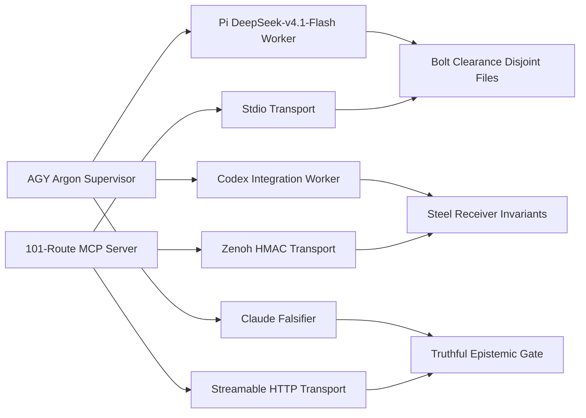

# ak47-multi-agent-mcp-symbiosis

Locally authored UOS skill, observed 2026-10-30T10:58:00Z; external originals remain read-only. Authority: [`SC-AK47-SYMBIOSIS-001`](http://nas-1.tail55d152.ts.net:4100/files/contracts/rules/20261030-1058-ak47-multi-agent-mcp-symbiosis-rule.md). Grants no effect authority and no runtime admission; capsule/configuration adoption is observed in the bounded operational note below.

Tags: #fractal-l0 #fractal-l1 #fractal-l2 #fractal-l3 #fractal-l4 #fractal-l5 #fractal-l6 #fractal-l7 #fractal-l8 #fractal-l9 #zk-adr #zero-muda #tailscale-web

**Navigation:** [Cockpit](http://nas-1.tail55d152.ts.net:4100/) · [Wiki](http://nas-1.tail55d152.ts.net:4100/wiki) · [ZK](http://nas-1.tail55d152.ts.net:4100/zk) · [Rule](http://nas-1.tail55d152.ts.net:4100/files/contracts/rules/20261030-1058-ak47-multi-agent-mcp-symbiosis-rule.md) · [Guide](http://nas-1.tail55d152.ts.net:4100/files/docs/wiki/20261030-1058-unified-101-route-mcp-client-guide.md) · [ADR](http://nas-1.tail55d152.ts.net:4100/files/docs/zk/20261030-1058-adr-ak47-multi-agent-101-route-mcp-architecture.md) · [Skill mirror](http://nas-1.tail55d152.ts.net:4100/files/governance/agents/20261001-1118-skills/ak47-multi-agent-mcp-symbiosis/SKILL.md)

Transclusions: `[[wiki:20261030-1058-unified-101-route-mcp-client-guide]]` · `[[zk:20261030-1058-adr-ak47-multi-agent-101-route-mcp-architecture]]`

## When to use

Use this skill when supervising parallel agent workers, when binding a new client to the unified Gleam/OTP MCP server, or when auditing whether a claim about routes, transports or readiness is truthful.

## Supersession of stale external paths

The read-only imported skills carry stale external paths authored before UOS was canonical:

- `governance/agents/20261025-1953-imported-skills/pi-prompt/SKILL.md` points at `/home/an/dev/ver/c3i/sub-projects/pi-mono/packages/coding-agent/dist/cli.js` and `/home/an/dev/ver/c3i/sub-projects/scripts-gleam`.
- `governance/agents/20261025-1953-imported-skills/codex-symbiosis/SKILL.md` points at `docs/CODEX_SYMBIOSIS.md`, `docs/AGENT_HANDOVER.md`, `docs/AUTONOMOUS_RUNBOOK.md` and `skills/harness-supervisor/SKILL.md`.

**Do not mutate the imported originals.** This UOS-local skill supersedes those paths: the canonical root is `/home/an/NAS-setup/uos`, the canonical rule is `contracts/rules/20261030-1058-ak47-multi-agent-mcp-symbiosis-rule.md`, and the canonical client guide is `docs/wiki/20261030-1058-unified-101-route-mcp-client-guide.md`. Resolve a stale path by reading this skill and the canonical rule, never by editing the read-only import.

## AK-47 discipline in one paragraph

Keep the **steel receiver** — authority, safety, admission, provenance, secret hygiene, effect fencing and the 28-module critical control path — unbreakable. Give the **bolt-clearance** parallel workers exactly one disjoint file set each and no shared dispatcher. Apply **Zero Muda**: pull only dependency-ready slices, merge verified work, then stop. `AGY Argon` supervises, integrates and verifies but does not implement what it approves.

## Worker lanes

| Lane | Model / flags | Scope |
|---|---|---|
| Supervisor / integrator / verifier | `AGY Argon` | coordination, serialized `integration/main` epoch, final verification |
| Fast disjoint slices | `Pi + DeepSeek-v4.1-Flash` `--thinking low` + 8-flag Zero-Muda isolation bundle | bounded new-file work at a measured **-99.2% prompt-token overhead** |
| Complex integration / security | `Codex` | multi-file integration and security-sensitive slices |
| Independent falsification | `Claude` `--allowedTools Read` | cross-family Popperian falsification; may return `HOLD` |

## Unified 101-route MCP server

`65` public routes across **9 domain adapters** + `21` development routes + `15` successor routes = **101**. Transports: **stdio**, **Zenoh** with HMAC fence, and **Streamable HTTP** with Bearer / Origin / session fence; the `http_auth.gleam` Origin allowlist is HTTPS-only and Tailscale-FQDN-shaped (`https://nas-1.tail55d152.ts.net:4101`; `http://` and raw IP literals are refused). Protocol versions **`2024-11-05`** (`Legacy20241105`) and **`2026-07-28`** (`Modern20260728`), with compatibility aliases implemented in `mcp/version.gleam` and `transports/http.gleam`. A declared route is not a connected route; verify the live tool list before relying on it. `Refused` is not `Operational`; completed tasks alone are not green readiness; raw review cannot be overridden; `DEV_READY` is not `SYSTEM_ADMITTED`; a live cutover needs separate T24 operator release authority.

**Legacy catalog distinction.** The pinned `mcp/tools.gleam` catalog declares65 tools and advertises53 operational names after12 unavailable entries. That legacy categorization is distinct from the unified registry public65 specs (53 operational tools +12 facilities). Live `tools/list` advertises53; all101 registry routes are wired, while missing backend/grant/fence conditions continue to refuse honestly. Counts alone do not establish individual effect admission.

## Observed operational binding — S01..S04

Observed under operator SC-HARNESS-MCP-001 Clause 9 development bootstrap and separate ReleaseAuthority, Sa-plan `20261030-1634-mcp-full-symbiosis-closure`: immutable OTP 29 / ERTS 17.0.5 capsule `20261030-1811-79c8aa73a27a372e027e3fa677b75deae56e4fd1a1f84af6632b4409e82ba1e2` is selected by `var/releases/ecology/current-mcp-release` and verified by `tools/uos-mcp-stdio`. All 101 gateway routes are wired (65 public, including 53 operational tools + 12 server/resource/prompt/task/logging/completion facilities; 21 development; 15 successor). Private execution remains real-grant/task/fence gated; wiring does not grant authority or make unavailable backends available. Four native client bindings (AGY/Gemini, Claude, Codex, Pi) have 11-file capsule/payload-pin parity. Live authenticated stdio, Streamable HTTP `:4100/mcp`, and OTP-supervised Zenoh `indrajaal/mcp/request/**` round-trips passed, including HTTP 401 and forged-HMAC silent-drop checks with a valid ping bracket. See the [cutover receipt](http://nas-1.tail55d152.ts.net:4100/files/var/harness/20261030-s03-symbiosis-cutover/s03-outcome.json) and [native CLI proof ledger](http://nas-1.tail55d152.ts.net:4100/files/var/harness/20261030-s03-symbiosis-cutover/s04-4agent-cli-proofs.json). `application_admitted = false`, `SYSTEM_ADMITTED = false`, `system_admission = "NOT_ADMITTED"`, `admitted_ev_ceiling = 93`; EV-94..EV-109 remain NOT_ADMITTED and no EV number is minted. Cockpit HTTP200 does not imply semantic quorum health (observed `quorum_healthy=false`).

## Diagram (SC-DIAGRAM-001)

```text
[AGY Argon Supervisor] --> [Pi DeepSeek-v4.1-Flash Worker]
[AGY Argon Supervisor] --> [Codex Integration Worker]
[AGY Argon Supervisor] --> [Claude Falsifier]
[Pi DeepSeek-v4.1-Flash Worker] --> [Bolt Clearance Disjoint Files]
[Codex Integration Worker] --> [Steel Receiver Invariants]
[Claude Falsifier] --> [Truthful Epistemic Gate]
[101-Route MCP Server] --> [Stdio Transport]
[101-Route MCP Server] --> [Zenoh HMAC Transport]
[101-Route MCP Server] --> [Streamable HTTP Transport]
[Stdio Transport] --> [Bolt Clearance Disjoint Files]
[Zenoh HMAC Transport] --> [Steel Receiver Invariants]
[Streamable HTTP Transport] --> [Truthful Epistemic Gate]
```



## Sovereign Model Role Boundary, Quota/Budget Failover & Lean 4 <-> Mojo C-ABI Interop (`SC-MODEL-ROLE-TWIN-001`)

- **Minimize `OpenRouter + Gemini + Argon` (`Caste02`)**: Strictly restricted to **Supervisor & Analyst** duties (high-level orchestration, Sa-Plan task state tracking, cross-plane synthesis, and final report presentation).
- **Maximize `Claude`, `Codex`, and `Local Qwen2.5-Coder-7B` (`http://razr15-1.tail55d152.ts.net:8000`)**: Used for ALL other activities — deep analysis, planning, implementation, code generation, testing, SDLC, SRE, and all system artifacts (`AGENTS.md`, rules, skills, superpowers, prompts, plans, journals).
- **Deterministic Multi-Agent Quota/Budget/Outage Failover (`tools/uos-agent-failover`)**:
  - Proven across 32 boolean states in `formal/lean/UosFullSystemCodeUnifiedDigitalTwin.lean` (`THM_FSYS_13..16`), `formal/lean/UosLeanRuntimeGuard.lean` (`uos_lean_select_failover_agent`), `formal/mojo/lean_ffi_bridge.mojo`, `apps/cepaf_gleam/src/cepaf_gleam/harness/agent_ecology.gleam` (`select_failover_agent`), and `tools/uos-agent-failover --selftest` (16/16 checks PASS).
  - If any primary agent is unavailable, times out, returns empty output, or exhausts quota/budget (`HTTP 429`, `HTTP 402`, `insufficient_quota`, `rate_limit`), execution automatically fails over down `Claude -> Codex -> Local Qwen2.5-Coder-7B` without routing execution workloads to the Supervisor.
- **In-Process Lean 4 <-> Mojo C-ABI Interoperability & 12 Qwen Closed Loops (`SC-PI-QWEN-SYMBIOSIS-001`)**:
  - `formal/lean/UosLeanRuntimeGuard.lean` compiles to `var/zlp/libuos_lean_guard.so` and `formal/lean/libuos_lean_guard.so` exporting 42 unboxed C-ABI functions (`THM_GUARD_01..42`, `44,380` states across Exports `#28..#42`), plus Section 42 (`THM_QLOOP_01..04`, `3,840` states across the **12 Qwen Control `C1..C4`, Data `D1..D4`, and Observability `O1..O4` Loops**).
  - `formal/mojo/lean_ffi_bridge.mojo`, `formal/mojo/full_system_code_oracle.mojo` (`104/104` checks), `formal/mojo/uos_mtest_framework.mojo` (`42/42` tests, `100/100` checks), and `services/inference/max/max_qwen_server.py` load `libuos_lean_guard.so` in-process (`49.5 ns/call`).
  - Inspect live Qwen Control/Data/Observability loops with `./tools/uos-qwen --loops`, actuate closed-loop `POODAVR` profiles with `./tools/uos-qwen --control-loop <layer_idx> <profile>`, and verify all 42 tests via `./tools/uos-ltest`.

## Comprehensive verification checklist

Checks below are obligations, not blanket passing claims.

<details><summary>Domain 1 — Metadata, timestamp and Tailscale navigation</summary>

- [x] **CHK-01-TIME** — `20261030-1058` prefix recorded.
- [x] **CHK-02-TAIL** — Full Tailnet links provided; live serving status not asserted here.
- [x] **CHK-03-FRACT** — L0–L9 tags plus `#zk-adr #zero-muda #tailscale-web`.
- [x] **CHK-04-KM** — Wiki and ZK transclusions plus rule/guide/ADR links present.

</details>

<details><summary>Domain 2 — Zero-Muda purity and storage safety</summary>

- [ ] **CHK-05-MUDA** — Dependency exclusion scan UNRUN.
- [ ] **CHK-06-GRAPH** — Pure BEAM/Hermes graph boundary UNRUN.
- [ ] **CHK-07-DRIVE** — OS storage interlock execution UNRUN.

</details>

<details><summary>Domain 3 — Testing Gold Standard and mathematical gates</summary>

- [ ] **CHK-08-C1C8** — Applicable C1–C8 surfaces UNRUN.
- [ ] **CHK-09-MATH** — Four declared mathematical gates UNRUN.
- [x] **CHK-10-9MOD** — Applicable source, transport, bounds, mutation and native-CLI observations recorded in S03/S04 receipts; no all-modalities claim.
- [ ] **CHK-11-REGR** — Regressions and bounded observation UNRUN.

</details>

<details><summary>Domain 4 — Cross-language control and observability</summary>

- [x] **CHK-12-GLEAM** — Actual OTP29 supervision and native MCP behavior observed under operator authority; private effects remain separately gated.
- [ ] **CHK-13-HERMES** — Bounded analysis and authoritative evidence UNRUN.
- [ ] **CHK-14-ZIGVM** — Deterministic execution and descriptor-relative VFS UNRUN.
- [ ] **CHK-15-MAX** — Isolated inference UNRUN.
- [ ] **CHK-16-OTEL** — Clock and nonzero trace/span identity UNRUN.

</details>

<details><summary>Domain 5 — Sovereign governance and standalone Jujutsu</summary>

- [x] **CHK-17-SOV** — Independent Claude source reviews PASS and operator ReleaseAuthority recorded; global/application admission remains NOT_ADMITTED.
- [x] **CHK-18-JJ** — Standalone JJ identities and scoped source preservation observed; final S04 completion and main integration remain supervisor-owned.

</details>

<details><summary>Domain 6 — Provenance extension</summary>

EV ceiling remains 93. EV-94..109 remain NOT_ADMITTED. No new EV number is minted.

</details>

**UOS footer:** document and component evidence do not grant system admission.


## 20261031-1807 — All-agent heartbeat, preflight and evolution binding

#fractal-l0 #fractal-l1 #fractal-l2 #fractal-l3 #fractal-l4 #fractal-l5 #fractal-l6 #fractal-l7 #fractal-l8 #fractal-l9 #km-triad #zk-adr #zero-muda

Use the [canonical monitoring SOP](http://nas-1.tail55d152.ts.net:4100/files/docs/sop/20261031-1807-all-agent-symbiosis-preflight-tps-and-evolution-sop.md) and [SC-SYMBIOSIS-PREFLIGHT-001](http://nas-1.tail55d152.ts.net:4100/files/contracts/rules/20261031-1807-all-agent-symbiosis-monitoring-contract.md) for Claude, Pi, AGY and Codex. Follow heartbeat/deep cadence, exact per-agent service coverage, source/clock freshness, verified recovery, scoped TPS/RCA, private cost reconciliation and current Sa-plan authority. Typed Rete outputs and Stan posteriors remain advisory; STANAG source admissibility is separate. Production owner/collector/catalog/effect gates are not established by this guidance. Preserve imported/historical originals and global files.

<details><summary>Domain 6 — Provenance extension for this addendum</summary>

EV93 ceiling; EV94..109 / ADR071..086 NOT_ADMITTED. Existing18 core-check obligations remain in force; no blanket pass or new EV identifier.

</details>


## 20261031-1807 — Current operator supervision and cost binding

For the active handover/full-symbiosis work, Codex supervises and integrates; Pi executes bounded eligible slices with the cheapest capable currently allowlisted model; Claude provides independent review and independently reviewed disjoint execution; AGY supplies peer/design/sovereign review. This current operator binding supersedes earlier AGY-only supervisor prescriptions for this work while preserving historical observations. An implementer never supplies its own independent acceptance. Local Codex relays must not be labeled native Pi/Claude execution.

Use [SC-SYMBIOSIS-PREFLIGHT-001](http://nas-1.tail55d152.ts.net:4100/files/contracts/rules/20261031-1807-all-agent-symbiosis-monitoring-contract.md) and the [all-agent SOP](http://nas-1.tail55d152.ts.net:4100/files/docs/sop/20261031-1807-all-agent-symbiosis-preflight-tps-and-evolution-sop.md). Price/usage must be observed within existing per-request/aggregate bounds. Added credits do not raise daily policy; unknown liabilities remain HOLD. Historical prompt-overhead improvements are scoped measurements, not a current universal speedup guarantee. Periodic monitors, role/rule registration and these addenda confer no runtime enforcement, deployment authority or system admission; EV93 remains the ceiling.


## 20261101-0621 — Capability ontology and MCP-first intent work

#fractal-l0 #fractal-l1 #fractal-l2 #fractal-l3 #fractal-l4 #fractal-l5 #fractal-l6 #fractal-l7 #fractal-l8 #fractal-l9 #zero-muda

**Status: isolated development draft / NOT_ADMITTED.** For work that unifies four-agent capability descriptions or controller intents, preserve separate runtime, provider, exact model, authenticated identity, capability, observation, authority and evidence coordinates. An intent describes requested work; it cannot create permission or establish service availability. Use the closed, typed intent surface and ordered effect semantics described by the candidate design specification; reject unknown/generic execution requests.

Route required capability operations through authenticated MCP and Gleam/OTP ownership, with Sa-plan task and effect-time fences. A registry entry or successful parse does not prove runtime support. A model response may evidence that inference occurred, but does not prove the requested downstream work or grant authority; a relay identity or board acknowledgement proves neither. Keep unsupported or stale observations UNKNOWN, and reconcile an uncertain outcome before retrying an effect.

An operator-authorized direct provider review is a temporary fallback only when the needed MCP review interface is unavailable. The provider call itself is an external and potentially billable effect, authorized only for that bounded review. It supplies advisory input and grants no separate authority to mutate tasks, perform other runtime effects, release, deploy or admit. Record actual provider/model/outcome and unresolved usage, then migrate the capability behind MCP. If MCP is unavailable for a requested task effect, HOLD that effect. Never label a local Codex relay as native Pi, Claude or AGY execution.

Independent review remains separate from implementation: current work roles are Codex supervision/integration, Pi bounded eligible execution, Claude independent review, and AGY peer/design/sovereign review. Obtain actual identity and candidate-bound review evidence; no worker accepts its own implementation. **Pressure testing for this skill addendum is UNRUN**; no compliance claim follows from these instructions. EV-93 remains the ceiling; above-ceiling EV and ADR claims remain NOT_ADMITTED.
