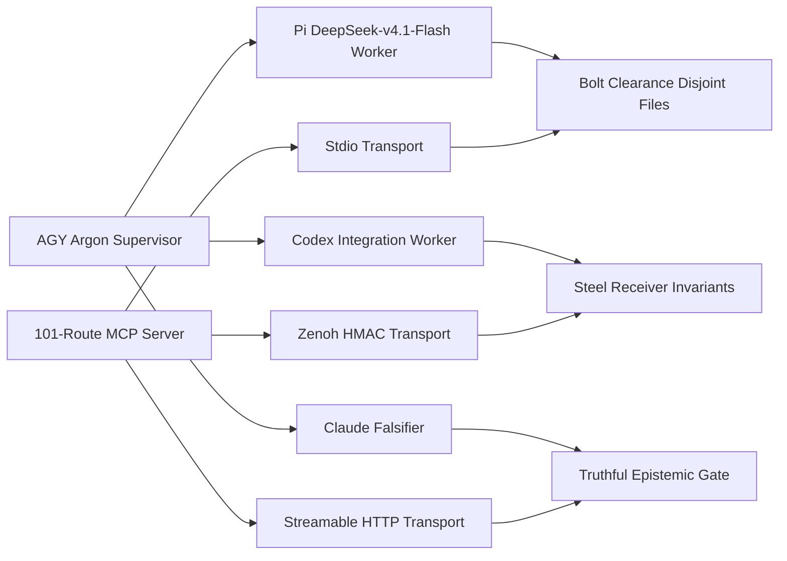

# ak47-multi-agent-mcp-symbiosis

Locally authored UOS skill, observed 2026-10-30T10:58:00Z; external originals remain read-only. Authority: [`SC-AK47-SYMBIOSIS-001`](http://nas-1.tail55d152.ts.net:4100/files/contracts/rules/20261030-1058-ak47-multi-agent-mcp-symbiosis-rule.md). Grants no effect authority and no runtime admission; client adoption is **UNRUN**.

Tags: #fractal-l0 #fractal-l1 #fractal-l2 #fractal-l3 #fractal-l4 #fractal-l5 #fractal-l6 #fractal-l7 #fractal-l8 #fractal-l9 #zk-adr #zero-muda #tailscale-web

**Navigation:** [Cockpit](http://nas-1.tail55d152.ts.net:4100/) · [Wiki](http://nas-1.tail55d152.ts.net:4100/wiki) · [ZK](http://nas-1.tail55d152.ts.net:4100/zk) · [Rule](http://nas-1.tail55d152.ts.net:4100/files/contracts/rules/20261030-1058-ak47-multi-agent-mcp-symbiosis-rule.md) · [Guide](http://nas-1.tail55d152.ts.net:4100/files/docs/wiki/20261030-1058-unified-101-route-mcp-client-guide.md) · [ADR](http://nas-1.tail55d152.ts.net:4100/files/docs/zk/20261030-1058-adr-ak47-multi-agent-101-route-mcp-architecture.md) · [Skill mirror](http://nas-1.tail55d152.ts.net:4100/files/governance/agents/20261001-1118-skills/ak47-multi-agent-mcp-symbiosis/SKILL.md)

Transclusions: `[[wiki:20261030-1058-unified-101-route-mcp-client-guide]]` · `[[zk:20261030-1058-adr-ak47-multi-agent-101-route-mcp-architecture]]`

## When to use

Use this skill when supervising parallel agent workers, when binding a new client to the unified Gleam/OTP MCP server, or when auditing whether a claim about routes, transports or readiness is truthful.

## Supersession of stale external paths

The read-only imported skills carry stale external paths authored before UOS was canonical:

- `governance/agents/20261025-1953-imported-skills/pi-prompt/SKILL.md` points at `/home/an/dev/ver/c3i/sub-projects/pi-mono/packages/coding-agent/dist/cli.js` and `/home/an/dev/ver/c3i/sub-projects/scripts-gleam`.
- `governance/agents/20261025-1953-imported-skills/codex-symbiosis/SKILL.md` points at `docs/CODEX_SYMBIOSIS.md`, `docs/AGENT_HANDOVER.md`, `docs/AUTONOMOUS_RUNBOOK.md` and `skills/harness-supervisor/SKILL.md`.

**Do not mutate the imported originals.** This UOS-local skill supersedes those paths: the canonical root is `/home/an/NAS-setup/uos`, the canonical rule is `contracts/rules/20261030-1058-ak47-multi-agent-mcp-symbiosis-rule.md`, and the canonical client guide is `docs/wiki/20261030-1058-unified-101-route-mcp-client-guide.md`. Resolve a stale path by reading this skill and the canonical rule, never by editing the read-only import.

## AK-47 discipline in one paragraph

Keep the **steel receiver** — authority, safety, admission, provenance, secret hygiene, effect fencing and the 28-module critical control path — unbreakable. Give the **bolt-clearance** parallel workers exactly one disjoint file set each and no shared dispatcher. Apply **Zero Muda**: pull only dependency-ready slices, merge verified work, then stop. `AGY Argon` supervises, integrates and verifies but does not implement what it approves.

## Worker lanes

| Lane | Model / flags | Scope |
|---|---|---|
| Supervisor / integrator / verifier | `AGY Argon` | coordination, serialized `integration/main` epoch, final verification |
| Fast disjoint slices | `Pi + DeepSeek-v4.1-Flash` `--thinking low` + 8-flag Zero-Muda isolation bundle | bounded new-file work at a measured **-99.2% prompt-token overhead** |
| Complex integration / security | `Codex` | multi-file integration and security-sensitive slices |
| Independent falsification | `Claude` `--allowedTools Read` | cross-family Popperian falsification; may return `HOLD` |

## Unified 101-route MCP server

`65` public routes across **9 domain adapters** + `21` development routes + `15` successor routes = **101**. Transports: **stdio**, **Zenoh** with HMAC fence, and **Streamable HTTP** with Bearer / Origin / session fence; the `http_auth.gleam` Origin allowlist is HTTPS-only and Tailscale-FQDN-shaped (`https://nas-1.tail55d152.ts.net:4100`; `http://` and raw IP literals are refused). Protocol versions **`2024-11-05`** (`Legacy20241105`) and **`2026-07-28`** (`Modern20260728`), matching `mcp/version.gleam` and `transports/http.gleam`. A declared route is not a connected route; verify the live tool list before relying on it. `Refused` is not `Operational`; completed tasks alone are not green readiness; raw review cannot be overridden; `DEV_READY` is not `SYSTEM_ADMITTED`; a live cutover needs separate T24 operator release authority.

**Catalog reconciliation note (`tools.gleam`).** The public catalog declares **65** public tools: **53** are listed directly in the default legacy unauthenticated `tools/list` (`tools.operational_tool_definitions()` = 65 declared minus 12 unavailable), and **12** gated domain tools (`control_loop`, `safety_status`, `run_selfcheck`, `registry_status`, `run_gate`, `zk_search`, `sa_bridge_submit`, `vault_status`, `vault_list_secrets`, `vault_policy_get`, `vault_audit_tail`, `vault_health`) fail closed with `UNAVAILABLE` on unauthenticated/unconfigured legacy calls and execute only through authenticated typed adapters in `server.execute_route_authenticated`. `65 declared − 12 unavailable = 53 advertised`, matching the T19 receipt's `tools_listed_count: 53`; `tools/list` and `tools/call` must tell the same story.

## Diagram (SC-DIAGRAM-001)

```text
[AGY Argon Supervisor] --> [Pi DeepSeek-v4.1-Flash Worker]
[AGY Argon Supervisor] --> [Codex Integration Worker]
[AGY Argon Supervisor] --> [Claude Falsifier]
[Pi DeepSeek-v4.1-Flash Worker] --> [Bolt Clearance Disjoint Files]
[Codex Integration Worker] --> [Steel Receiver Invariants]
[Claude Falsifier] --> [Truthful Epistemic Gate]
[101-Route MCP Server] --> [Stdio Transport]
[101-Route MCP Server] --> [Zenoh HMAC Transport]
[101-Route MCP Server] --> [Streamable HTTP Transport]
[Stdio Transport] --> [Bolt Clearance Disjoint Files]
[Zenoh HMAC Transport] --> [Steel Receiver Invariants]
[Streamable HTTP Transport] --> [Truthful Epistemic Gate]
```



## Comprehensive verification checklist

Checks below are obligations, not blanket passing claims.

<details><summary>Domain 1 — Metadata, timestamp and Tailscale navigation</summary>

- [x] **CHK-01-TIME** — `20261030-1058` prefix recorded.
- [x] **CHK-02-TAIL** — Full Tailnet links provided; live serving status not asserted here.
- [x] **CHK-03-FRACT** — L0–L9 tags plus `#zk-adr #zero-muda #tailscale-web`.
- [x] **CHK-04-KM** — Wiki and ZK transclusions plus rule/guide/ADR links present.

</details>

<details><summary>Domain 2 — Zero-Muda purity and storage safety</summary>

- [ ] **CHK-05-MUDA** — Dependency exclusion scan UNRUN.
- [ ] **CHK-06-GRAPH** — Pure BEAM/Hermes graph boundary UNRUN.
- [ ] **CHK-07-DRIVE** — OS storage interlock execution UNRUN.

</details>

<details><summary>Domain 3 — Testing Gold Standard and mathematical gates</summary>

- [ ] **CHK-08-C1C8** — Applicable C1–C8 surfaces UNRUN.
- [ ] **CHK-09-MATH** — Four declared mathematical gates UNRUN.
- [ ] **CHK-10-9MOD** — Nine runtime test modalities UNRUN.
- [ ] **CHK-11-REGR** — Regressions and bounded observation UNRUN.

</details>

<details><summary>Domain 4 — Cross-language control and observability</summary>

- [ ] **CHK-12-GLEAM** — Actual OTP control/supervision behavior UNRUN.
- [ ] **CHK-13-HERMES** — Bounded analysis and authoritative evidence UNRUN.
- [ ] **CHK-14-ZIGVM** — Deterministic execution and descriptor-relative VFS UNRUN.
- [ ] **CHK-15-MAX** — Isolated inference UNRUN.
- [ ] **CHK-16-OTEL** — Clock and nonzero trace/span identity UNRUN.

</details>

<details><summary>Domain 5 — Sovereign governance and standalone Jujutsu</summary>

- [ ] **CHK-17-SOV** — Candidate-bound independent review and authorized admission NOT_ADMITTED.
- [ ] **CHK-18-JJ** — Standalone JJ, source ownership and exact candidate identity UNRUN.

</details>

<details><summary>Domain 6 — Provenance extension</summary>

EV ceiling remains 93. EV-94..109 remain NOT_ADMITTED. No new EV number is minted.

</details>

**UOS footer:** document and component evidence do not grant system admission.
