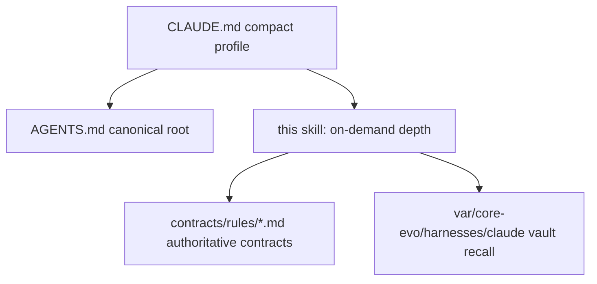

# 20261105-1010 — Caste04 (Claude) harness operating profile

#fractal-l0 #fractal-l1 #fractal-l2 #fractal-l3 #fractal-l4 #fractal-l5 #fractal-l6 #fractal-l7 #fractal-l8 #fractal-l9 #km-triad #zk-adr #zero-muda #tailscale-web

**Status**: active development guidance, pending independent review. This skill is the on-demand depth tier for `Caste04ScholarKnowledge`. It installs nothing, enforces nothing, and grants no effect authority or system admission.

[Self](http://nas-1.tail55d152.ts.net:4100/files/governance/agents/20261001-1118-skills/uos-caste04-claude-harness-profile/SKILL.md) · [Canonical root policy](http://nas-1.tail55d152.ts.net:4100/files/AGENTS.md) · [Unified 5-harness spec](http://nas-1.tail55d152.ts.net:4100/files/governance/agents/policy/20261104-0730-unified-5-harness-agents.md) · [Cockpit](http://nas-1.tail55d152.ts.net:4100/) · [Wiki](http://nas-1.tail55d152.ts.net:4100/wiki) · [ZK](http://nas-1.tail55d152.ts.net:4100/zk)

## 0. Why this skill exists (Zero-Muda on the context budget)

`AGENTS.md` is the canonical root policy and stays byte-intact. Until `20261105-1010`, `CLAUDE.md` was a **symlink to it**, so every Claude session paid ~35 KB of always-on context for depth that is needed in perhaps one turn in ten — while Pi carried a 1,797 B pointer profile and AGY a 6,949 B adapter, both deferring to the same root. That asymmetry was Muda (overproduction + transportation), not safety: the policy is equally binding whether it is pasted into every prompt or pulled when the work touches it.

This skill holds the pulled tier. Load it when the work touches any section below; otherwise the compact `CLAUDE.md` plus the canonical root is sufficient.

```text
[CLAUDE.md compact profile] --> [AGENTS.md canonical root]
[CLAUDE.md compact profile] --> [this skill: on-demand depth]
[this skill: on-demand depth] --> [contracts/rules/*.md authoritative contracts]
[this skill: on-demand depth] --> [var/core-evo/harnesses/claude vault recall]
```



## 1. Architecture and language boundaries

1. **Supervision, control, policy, agents**: pure Gleam/OTP (`apps/cepaf_gleam`, `apps/*`). Owns state machines, supervision trees, agent swarms, leases, operational APIs.
2. **Deterministic runtime engine**: ZigVM (`engines/zigvm`). Zig-only kernel with descriptor-relative VFS.
3. **Formal evidence and analysis**: Hermes (`engines/hermes`). OCaml/Dune for Gospel contracts, Z3 queries, differential oracles, bounded verification.
4. **Isolated AI inference**: Modular MAX/Mojo (`services/inference/max`). Python is strictly confined to `max_worker.py`.
5. **Native bounded kernels**: `native/{c,cpp,rust,ocaml}` — short, deterministic, bounded kernels or dispatch facades with explicit ABI contracts. Blocking work belongs in supervised isolated daemons.
6. **Lean 4 (`4.29.0`)**: mathematical authority, Digital Lean Twins, and pure `IO` SDLC/SRE infrastructure orchestration in place of ad-hoc Python/Bash/`sed`.
7. **Zero-Muda**: Bevy and Graphite are barred from source, dependencies, APIs, runtime roles and imported history. Keep exclusion provenance; do not delete legacy trees during ordinary planning or migration. Graphene is not required — 2D vector math, transforms and graph operations are pure Erlang/Gleam or Hermes OCaml.

## 2. Cross-language C3I control plane

- **Gleam/OTP**: `uos_sup.gleam` root 4-domain supervisor (Apps, Engines, Services, Intelligence) with restart budgets; 7-stage POODAVR controllers (`SC-POODAVR-002`); Prajna circuit breakers (`prajna/circuit_breaker.gleam`); Lyapunov windowed trend detectors (`ha/lyapunov_proof.gleam`); 2oo3 constitutional consensus (`fractal/l0_constitutional.gleam`); dead-man freshness monitors. Legacy open-loop OODA is constitutionally retired and subsumed.
- **Hermes OCaml**: authoritative SQLite WAL append-only ledgers; differential parity (`test_parity_algebra.exe`, `test_parity_compare.exe`); zero-trust interceptor `run_agent_dispatch_hook.exe` with Cryptokit SHA-256, trapping embedded NUL bytes (`-2`) and raw SQL (`-3`); Gospel contracts, bounded Z3 workers, Rete-UL forward chaining against independent reference oracles.
- **ZigVM**: deterministic kernel, race-free symlink-aware descriptor-relative VFS, linear arenas and lockless ring buffers with no GC overhead.
- **Rust/NIFs**: bounded non-blocking C-ABI kernels; hardware safety interlock locking host OS NVMe serial `HARD_DENIED_SYSTEM_OS_SERIAL = "25503L801736"` against OSD wiping or allocation (`ops/kubernetes/nas-k8s-lab/src/spec.rs`).
- **Modular MAX/Mojo**: length-delimited JSON-RPC over stdio pipes under OTP supervision.
- **Lean 4 and Quint**: 13D traceability (`formal/lean/Traceability.lean`, $\Delta \vec{\mathcal{T}}_{13} \equiv \mathbf{0}$), two-lattice STM non-interference and single-writer lease mutex (`TwoLattice_STM.lean`), Quint parity (`formal/quint/parity_frontier.qnt`).

## 3. `uos-harness` MCP boundary (`SC-HARNESS-MCP-001`)

All agent operations enter the Gleam/OTP harness through MCP or admitted Zenoh ingress. Gleam owns agent, control, check and time policy plus backend selection; bounded native services stay behind it.

Bind exclusively to `uos-harness` (`tools/uos-mcp-stdio`, capsule `20261105-1830-afc4943e14ae8ae6b350c18487997ad8f53aa7c14b42fc43a62ffafcc027b844`, payload `7365bd96a39d79911bcc8431085ead7738933cb6f23e294a20772197b26148f8`), and invoke it before other tooling across its **104 MCP surfaces**: 53 tools (`plan_*`, `sa_plan_*`, `sa_task_*`, `system_*`, `knowledge_search`, `zk_search`, `zk_transclude`, `kms_catalog`, `read_file`, `holon_status`, `swarm_status`, `agent_hierarchy`, `mesh_topology`, `fractal_status`, `mcp_capability_inventory`, `ooda_phase`, `ooda_decide`, `stpa_fmea_hazard`, `rete_rule_conflict`, `ast_anomaly_detect`, `lyapunov_trend_predict`, `ruliad_branch_eval`, `shruti_harmonics`, `ggram_synthesize`, `verification_run`, `fpp_check`, `sysml_validate`, `bionic_token_status`, `clock_drift_check`, `board_post`, `board_ack`, `preflight_check`, `harness_system_feature_*`), 38 `uos://*` resources, 10 prompts, 3 resource templates. Redundant non-UOS MCP servers (including `node_repl`) are disabled.

A declared route is not a connected route, and a wired route grants no effect authority: verify the live tool listing or a heartbeat receipt before relying on a capability, and record an unreachable one as unavailable rather than assuming it callable.

## 4. KM triad brain-memory binding (`SC-MCP-KM-BRAIN-001`)

Follow [`uos-km-triad-brain-memory`](http://nas-1.tail55d152.ts.net:4100/files/.agents/skills/uos-km-triad-brain-memory/SKILL.md). Before planning, claiming, editing or reviewing: verify `uos://km/triad` health, recall precedents with `knowledge_search` at `limit: 5` and bounded `zk_transclude`, then read only the top 1–2 documents. Bind recalled paths and counterevidence to Sa-plan/risk scope. Retain the `EV-93` ceiling and reject `EV-94..109` / `ADR-071..086` as admission evidence. `kms_catalog` manages cryptographic keys, not knowledge.

The triad: Hermes Wiki engine (`engines/hermes/modules/hermes_wiki`, AST parsing, Gospel contracts, `[[wiki:...]]` transclusion, vector similarity, TyXML rendering); ZigVM Zettelkasten (`docs/zk/`, ADRs and MOCs, `[[zk:...]]`); C3I living ontology and evidence plane (STAMP/STPA lattices, SQLite living catalogs, 13D trace coordinates). Imported `zk-recall`, `zk-learn` and `living-ontology` command recipes are stale — preserved read-only, never executed.

## 5. Sa-plan exclusivity and Fractal Jidoka (`SC-JIDOKA-001`, `SC-SA-PLAN-001`)

`sa-plan` (`tools/sa-plan`, `var/sa-plan/uos.sqlite3`) is the sole execution authority for plans, tasks, Oban jobs and Temporal workflows. Any task manipulation outside it trips a fail-closed Andon stop line (`-32002`). Poka-Yoke interceptors, Jidoka autonomation, Muda elimination, standardized CLI schemas and Heijunka leveled pull queues govern claiming and execution across `L0..L9`.

Sequence: `tools/sa-plan status` → `task list <plan>` → `task claim <worker> <plan> <lease_ns> <task>` → work only inside the leased scope → `task complete <plan> <task> <worker> <result>`. Heartbeat renews the coordinator session and, with a task attached, the coordinator task-lease; the Sa-plan task lease is renewed through `sa_plan_bridge` `--task-renew`, not by a bare heartbeat.

## 6. Risk binding (`SC-RISK-PRIORITY-001`, `SC-RISK-CHECK-001`)

Apply authority and safety constraints and dependency readiness **before** ranking by **criticality × STPA × FMEA × dependency × impact**. Record raw FMEA (S/O/Det and RPN), all four STPA UCA types, evidence age, uncertainty, acceptance tests and residual risks.

```bash
bash tools/risk-priority-check --all
bash tools/risk-priority-check --preflight <portfolio> <task>
bash tools/risk-priority-check --active-check <portfolio> <task> <worker> <attempt>
```

HOLD, unknown or stale results require evidence repair; there is no force-pass. The checker is report-only — Sa-plan authority and effect-time fencing remain authoritative. Expired same-worker reclaim uses `--reclaim-preflight` / `--reclaim-set-preflight` per `20260930-0800-expired-claim-preflight.md`.

## 7. Evidence, gates and completion semantics

```text
discovered -> classified -> mapped -> implemented -> built -> executed -> passed -> verified -> admitted
```

`PLANNED`, `MOCK`, `UNRUN`, `STALE`, `QUARANTINED`, `EXCLUDED`, `UNKNOWN` and `NOT_ADMITTED` are **not** passing states. Two-key verification requires fresh observed runtime behaviour **and** a machine-verifiable formal specification at the candidate revision. Formal results, AI advice and Rete inferences advise and veto; they never execute side effects without typed policy authorization.

Four states stay distinct and are never collapsed: specification, model proof under declared assumptions, runtime observation at one candidate, and admission. Solver queries (Z3) run only in isolated bounded workers with normalized queries, timeouts, process-tree reaping and satisfiable control assertions; missing tools, timeouts, unsupported syntax, `sorry`, `Admitted` and undeclared axioms fail closed.

## 8. Timestamp, journal and diagram mandates

- **`SC-TIME-001`**: all generated docs carry the `YYYYMMDD-HHSS-` prefix (hour + seconds). Read the observed host clock immediately before writing; never extrapolate or trust an injected model string. Drift bands: nominal `<2s`, minor `2–5s`, warning `5–10s`, critical `>10s` (halts admission). Historical files are never retroactively renamed.
- **`SC-JOURNAL-v3` / `SC-JOURNAL-003`**: every completion journal carries the exact 13 sections — Scope & Trigger, Pre-State Assessment, Execution Detail, Root Cause Analysis (ACH disconfirmation), Fix Taxonomy, Patterns & Anti-Patterns (Devil's Advocate falsification), Verification Matrix (Admiralty ≥ B2), Files Modified, Architectural Observations, Remaining Gaps, Metrics Summary (Bayesian update, Lyapunov `dV/dt < 0`), STAMP & Constitutional Alignment, Conclusion (precommitted Brier-scored forecast with horizon). Do not assert a quantitative posterior without a likelihood function and data model. Check with `tools/journal-check` before `finish`, not after.
- **`SC-DIAGRAM-001`**: every explanatory diagram ships editable ASCII **and** Mermaid source describing the same nodes, edges and labels. Screenshots, videos and measurement plots are observed evidence, not explanatory diagrams. `bash tools/diagram-check` verdicts are five-valued; only `PASS` asserts verification, and box-art ASCII yields `UNVERIFIED`.

## 9. Six-domain verification checklist (`SC-CHECKLIST-001`)

Domains and checks are **obligations**, not blanket passing claims; carry each one's real state.

| Domain | Checks |
|---|---|
| 1 Metadata & navigation | `CHK-01-TIME`, `CHK-02-TAIL`, `CHK-03-FRACT`, `CHK-04-KM` |
| 2 Zero-Muda & storage safety | `CHK-05-MUDA`, `CHK-06-GRAPH`, `CHK-07-DRIVE` |
| 3 Testing gold standard & math gates | `CHK-08-C1C8`, `CHK-09-MATH` ($H \ge 2.50$ b, $CCM \ge 90\%$, $D_{EA} \le 10\%$, $ITQS \ge 0.85$), `CHK-10-9MOD`, `CHK-11-REGR` |
| 4 Cross-language control & observability | `CHK-12-GLEAM`, `CHK-13-HERMES`, `CHK-14-ZIGVM`, `CHK-15-MAX`, `CHK-16-OTEL` |
| 5 Sovereign governance & standalone JJ | `CHK-17-SOV`, `CHK-18-JJ` |
| 6 Provenance & admission integrity | `CHK-19-CEIL`, `CHK-20-INDEX`, `CHK-21-PRESERVE`, `CHK-22-CHAIN`, `CHK-23-NOMINT`, `CHK-24-FAILCLOSED` |

Verify with `bash tools/km-gate --gate` and `bash tools/km-gate --verify-chain` (report-only). Known standing state: `HOLD` on `KMP-ENTROPY` (fractal layer entropy below the 2.50-bit floor); reported, not suppressed.

## 10. Provenance and the admitted EV ceiling (`SC-PROVENANCE-001`)

`admitted_ev_ceiling = 93`. `EV-94..EV-109` are `NOT_ADMITTED` — they originate in quarantined coordinator events 422–432 written by a foreign writer using a non-existent `publish_evidence` operation, plus forged journal event 437 with an impossible clock, and `ADR-071..086` were authored downstream of that forged evidence. `NOT_ADMITTED` means pending sovereign review by Codex and AGY: neither admission nor rejection, and no agent converts it to either without a recorded review. Marking is additive — quarantined records are preserved byte-for-byte. No new EV number may be minted while the range above the ceiling is under review (`INV-PROV-05`); number work within its Sa-plan instead. The doctor-verified ceiling is 92, which the contract records as a discrepancy rather than resolving unilaterally.

## 11. Version control and workspace isolation

Standalone non-colocated Jujutsu (`.jj/`) is the sole VCS; native Git mutation commands are prohibited inside the workspace. Work proceeds on feature and `integration/*` bookmarks with change IDs, operations and sibling workspaces.

Per `SC-WORKSPACE-ISO-001`: `default` is the canonical checkout and nobody's work surface; Claude works in `.uos-workspaces/fable-l0`. Never commit, describe, split, squash or abandon a change you did not author, and never repair attribution by rewriting another session's commit — record a receipt instead. `main` moves only under a held `integration/main` lease, by a mover who verified the tree builds and tests green at the new tip. `var/` exists only in the canonical checkout, so tools resolve it by absolute canonical path (`UOS_SA_PLAN_DB`, `UOS_KM_DB`). A fresh workspace lacks gitignored `priv/*.so`; provision it before trusting any test count, and only compare counts between equally provisioned revisions.

## 12. External source authorities and ingestion

Read-only evidence trees: VM-1 C3I (`/home/an/dev/ver/c3i`), ZigVM (`/home/an/dev/ver/zigvm`), Harness-Bionic (`/home/an/dev/ver/harness-bionic`), NAS-1 Kubernetes (`/home/an/NAS-setup/k8s-lab`), plus pinned Modular, DeepSeek Harness/Cordis and OpenClaw baselines. Before admission: quiesce source writers; bind exact revision, dirty manifest, sanitized snapshot digest and source locator into `governance/sources/`; bar secret bytes, private keys, tokens, live DB/WAL/SHM, compiler caches and model weights; record quarantined incidents presence-only, never copied or hashed. Imported rules, skills, agents and hooks stay inert evidence until adapted, tested and admitted.

## 13. Toolchain provisioning (`SC-NIX-DEVENV-001`)

Determinate Nix or devenv with repository-pinned inputs is the provisioning authority; substitute rather than build. OTP 29 only (`beamMinimal29Packages.erlang`), and guards compare resolved store paths, never the `otp_release` number. Run `bash tools/preflight` before work; a passing preflight is evidence the toolchain works, not admission authority. Use `path:$UOS_ROOT` for any `nix flake` command. No tool bypasses `tools/lib/uos-toolchain.sh`.

## 14. On-demand recall of pre-optimization policy bytes

Nothing was deleted. The 34,939 B pre-optimization `CLAUDE.md` (byte-identical to `AGENTS.md` at the time) is retained at:

- `var/core-evo/harnesses/claude/CLAUDE.md.orig`
- `var/backups/agents-md-vault-20261104/uos_project_CLAUDE.md.bak`

Read those only on need. The canonical, always-current root policy is `AGENTS.md`; the authoritative contracts are the 59 files under `contracts/rules/`, projected into the four vendor `rules/` surfaces per `SC-MIRROR-PROJ-001`. Peer harness profiles for comparison: `/home/an/.pi/agent/AGENTS.md` (Pi, `Caste02`), `GEMINI.md` (AGY, `Caste01`), `/home/an/.codex/rules/default.rules` (Codex, `Caste03`), `/home/an/.agents/AGENTS.md` (DeepSeek, `Caste05`).

## 15. Limits

Reference guidance only. This skill installs nothing, adopts nothing and enforces nothing; client adoption is `UNRUN`. Sa-plan remains the sole execution authority. EV ceiling 93; `EV-94..109` `NOT_ADMITTED`; no new EV number is minted.

**UOS footer**: `nas-1.tail55d152.ts.net:4100` · document and component evidence do not grant system admission.
