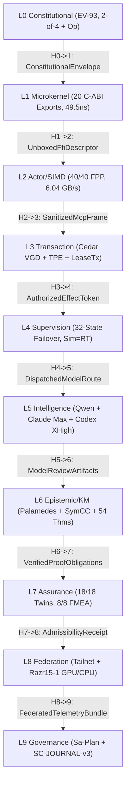

# Canonical Fractal Master Prompt: Usecase-Driven L0..L9 Context Pipeline, 15-Cycle Cedar VGD + Palamedes Deductive Synthesis, and Simulator-Twin-Realtime Bisimulation

#fractal-l0 #fractal-l1 #fractal-l2 #fractal-l3 #fractal-l4 #fractal-l5 #fractal-l6 #fractal-l7 #fractal-l8 #fractal-l9 #km-triad #zero-muda #zk-adr

- **Canonical Document URL**: [http://nas-1.tail55d152.ts.net:4100/files/governance/agents/prompts/20261107-1358-fractal-usecase-context-pipeline-and-15evo-master-prompt.md](http://nas-1.tail55d152.ts.net:4100/files/governance/agents/prompts/20261107-1358-fractal-usecase-context-pipeline-and-15evo-master-prompt.md)
- **Reference Document**: [http://nas-1.tail55d152.ts.net:4100/files/docs/design/20261107-1158-cedar-vgd-symcc-digital-twin-analysis-and-uos-mapping.md](http://nas-1.tail55d152.ts.net:4100/files/docs/design/20261107-1158-cedar-vgd-symcc-digital-twin-analysis-and-uos-mapping.md)
- **SC-JOURNAL-v3 Ledger**: [http://nas-1.tail55d152.ts.net:4100/files/docs/journal/20261107-0650-5round-fractal-lean-mojo-unification-journal.md](http://nas-1.tail55d152.ts.net:4100/files/docs/journal/20261107-0650-5round-fractal-lean-mojo-unification-journal.md)
- **Sa-Plans**: `uos/cedar-vgd-palamedes-15evo-cycles/20261107-1322` (`15/15 completed`) & `uos/fractal-context-pipeline-and-inductive-cedar-palamedes/20261107-1358` (`6/6 completed`)
- **Admitted EV Ceiling**: `EV-93` (`SC-PROVENANCE-001`, `admitted_ev_ceiling = 93`; `EV-94..109` `NOT_ADMITTED`, `INV-PROV-05`)

---

## 1. Mandatory 5-Step Fractal Execution Protocol

Every agentic cycle MUST execute in this exact sequence:
1. **STEP 1 — Create Fractal Prompt**: Define `L0..L9` semantic context packets and explicit `L_k -> L_{k+1}` inter-layer handoff contracts for the required usecase before touching code.
2. **STEP 2 — Explain As-Is vs. To-Be**: Enumerate exact features, architecture, and system gaps across Lean 4, Mojo, C-ABI FFI, OCaml Simulator, and Gleam OTP.
3. **STEP 3 — Register Sa-Plan in `var/sa-plan/uos.sqlite3`**: Insert plan (`state = 'executing'`) and task DAG before implementation (`SC-SA-PLAN-001`).
4. **STEP 4 — Build Materialized `L0..L9` Context Bundle (`tools/uos-fractal-context-pipeline --bundle <usecase> <task>`)**: Materialize all upstream definitions (`missing_upstream_defs == 0`) and verify `uos_lean_verify_fractal_context_chain(1023, 0, 9, 0) == 1`.
5. **STEP 5 — Execute & Verify Across Models**:
   - **Maximize Local Qwen (`Qwen2.5-Coder-7B-Instruct-Q4_K_M` on `http://razr15-1.tail55d152.ts.net:8000/v1/chat/completions`)**: Primary search, collateral digestion, and algorithm extraction (`0` remote tokens).
   - **Maximize Claude (`claude --model claude-opus-4-6 --effort max --tools "" -p`, unlimited time)**: Deep formal proof audit, inductive generalization, and ACH gap analysis.
   - **Maximize Codex (`codex exec --skip-git-repo-check -c model_reasoning_effort="xhigh" -s read-only`, unlimited time)**: Independent differential oracle verification, falsifiability audit, and simulator/twin/realtime parity check.
   - **Minimize `Pi+OpenRouter+Gemini+Argon`**: Strictly `SupervisorAnalyst` orchestration (`0` subagent tokens).

---

## 2. L0..L9 Usecase-Driven Context Pipeline & Inter-Layer Handoff Contracts

```text
[L0 Constitutional] --(H0->1: ev_ceiling=93, nvme_locked, 2of4_quorum)-->
[L1 Microkernel]    --(H1->2: 20 C-ABI symbols, 0 undef, 49.5ns FFI)-->
[L2 Actor/SIMD]     --(H2->3: 40/40 FPP actors, 6.04 GB/s AVX-512)-->
[L3 Transaction]    --(H3->4: Cedar VGD forbid>permit, TPE, slice, LeaseTx)-->
[L4 Supervision]    --(H4->5: 32-state failover cascade, Simulator=Realtime)-->
[L5 Intelligence]   --(H5->6: Local Qwen + Claude Opus max + Codex xhigh)-->
[L6 Epistemic/KM]   --(H6->7: Palamedes CorrectGen, SymCC, 18/18 Twins)-->
[L7 Assurance]      --(H7->8: 8/8 FMEA modes, 11/11 falsifiable arms)-->
[L8 Federation]     --(H8->9: Tailnet FQDN, Razr15-1 :8000/:8081)-->
[L9 Governance]     --(Final Seal: Sa-Plan completed, SC-JOURNAL-v3 10/10)
```


